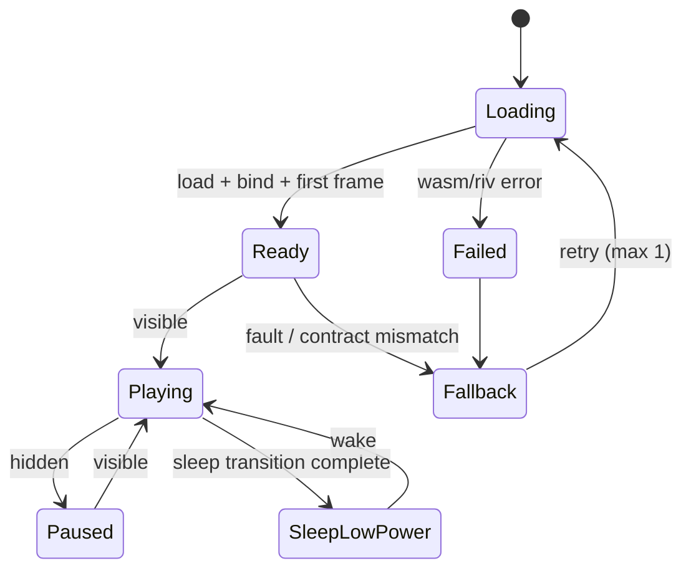

# Animation System

| Field | Value |
| --- | --- |
| Status | Approved for build |
| Version | 1.0 |
| Date | 2026-10-19 |
| Related | [Behavior engine](behavior-engine.md) · [Rive authoring contract](../03-design/rive-authoring-contract.md) · [ADR-0002](../04-adr/0002-rive-animation-runtime.md) · [ADR-0004](../04-adr/0004-rive-data-binding.md) |

The animation system turns a behavior decision into pixels. It owns the Rive runtime, asset loading, view-model binding, frame-loop power policy, and every failure path that could leave the pet blank. It does **not** decide what the pet does; that is the [behavior engine](behavior-engine.md).

## 1. Goals and constraints

| Goal | Constraint / mechanism |
| --- | --- |
| Character-grade motion | Rive state machine with layered breathing, blinking, and secondary motion; vector rendering at 60 fps |
| Zero network at runtime | WASM and `.riv` bundled; Rive CDN disabled; CSP allows only `app://` assets |
| Low idle cost | Canvas fixed at 200×220 DIP, DPR capped at 2, FX layer disabled in low-power mode, rendering paused when hidden |
| Deterministic integration | A typed view-model contract, a single command bridge, and CI validation of the `.riv` |
| Graceful failure | Static silhouette fallback; the app never shows a blank transparent window |
| Designer autonomy | Design owns timing and secondary motion inside Rive; engineering owns state selection and data |

## 2. Runtime choice

**Baseline:** `@rive-app/react-canvas` **4.37.0**, which depends on `@rive-app/canvas` **2.45.0** (WASM runtime).

Why the Canvas2D path:

- The canvas runtime is the most compatible renderer inside a transparent Electron window. It avoids WebGL2 context loss and GPU-driver interactions that are already a known risk for transparent windows (see [Desktop shell](desktop-shell.md#known-constraints-and-mitigations)).
- `@rive-app/canvas` 4.x exposes view-model hooks (`useViewModel`, `useViewModelInstance*`) and runtime methods needed for data binding, so WebGL2 is not required for our contract.
- The art is vector with modest fill complexity; Canvas2D meets the frame budget at 200×220 DIP.

**Alternative:** `@rive-app/react-webgl2` 4.37.0 is the measured fallback if Canvas2D misses frame budgets on low-end machines or if advanced effects are required. The runtime boundary is isolated in `src/renderer/pet/rive/`, so switching packages touches one adapter, not the app. The switch requires an ADR amendment and a full DPI/transparency regression pass.

Versions are pinned exactly. Rive minor upgrades are allowed after the contract validator and visual goldens pass; major versions require a manual QA pass.

## 3. Asset pipeline and offline loading

### 3.1 Files

| Asset | Source | Destination in package |
| --- | --- | --- |
| `mochi.riv` | Designer export from Rive Editor | `resources/rive/mochi.riv` |
| `mochi-golden.riv` | Test-only static poses | `tests/fixtures/rive/` |
| `rive.wasm` | `node_modules/@rive-app/canvas/rive.wasm` | `resources/rive/rive.wasm` |
| `rive_fallback.wasm` | `node_modules/@rive-app/canvas/rive_fallback.wasm` | `resources/rive/rive_fallback.wasm` |

The build copies both WASM files with a Vite plugin and includes them in `electron-builder` `extraResources`. Nothing is fetched from `unpkg`, jsDelivr, or the Rive asset CDN.

### 3.2 Runtime loader configuration

```ts
import { RuntimeLoader } from '@rive-app/react-canvas';

// Runs once, before the first <RiveComponent> mounts.
RuntimeLoader.setWasmUrl('app://assets/rive/rive.wasm');
RuntimeLoader.setWasmFallbackUrl('app://assets/rive/rive_fallback.wasm');
```

The fallback WASM is for CPUs without the required SIMD support. It is a local file, not a CDN. `enableRiveAssetCDN: false` is passed to `useRive` so a missing embedded asset cannot trigger a network request.

### 3.3 Content Security Policy

```
default-src 'none';
script-src 'self' 'wasm-unsafe-eval';
style-src 'self' 'unsafe-inline';
img-src 'self' data: blob:;
font-src 'self';
connect-src 'self';
media-src 'self';
```

- `wasm-unsafe-eval` is required to instantiate the Rive WASM. It does not allow arbitrary JavaScript `eval`.
- `connect-src 'self'` permits `app://` fetches for the `.riv` and WASM.
- No remote fonts, images, or analytics.

### 3.4 Versioning

- The Rive contract has a semantic version (`PET_RIVE_CONTRACT_VERSION`, currently `1`). The `.riv` filename is stable; the contract version is asserted by the validator and reported by the renderer at load.
- The app and the asset ship together. There is no hot-reload of art in production.
- A designer preview build can load a local file via a dev-only query parameter; it is rejected unless `isDev`.

## 4. Renderer component architecture

```
src/renderer/pet/
├─ PetApp.tsx                 // layout, bubble, input surface
├─ rive/
│  ├─ RiveStage.tsx           // useRive + canvas sizing + ready/error reporting
│  ├─ usePetViewModel.ts      // binds PetModel, returns typed setters
│  ├─ AnimationBridge.ts      // command queue, idempotency, acks, fault detection
│  └─ contract.ts             // names and types mirrored from shared/rive-contract.ts
├─ interaction/
│  ├─ HitTest.ts              // ellipse + bubble rect, hysteresis
│  ├─ DragController.ts       // pointer capture, threshold, IPC
│  └─ Bubble.tsx              // presentation, actions, aria-live
└─ styles.css
```

### 4.1 Hooks

```tsx
const { rive, RiveComponent } = useRive({
  src: 'app://assets/rive/mochi.riv',
  artboard: 'Mochi',
  stateMachine: 'PetSM',          // singular; `stateMachines` is deprecated
  autoplay: false,                // play after the first command is applied
  layout: new Layout({ fit: Fit.Contain, alignment: Alignment.BottomCenter }),
  enableRiveAssetCDN: false,
});

const viewModel = useViewModel(rive, { name: 'PetModel' });
const instance = useViewModelInstance(viewModel, { rive });
const setBehavior = useViewModelInstanceEnum('behavior', instance);
const setEnergy = useViewModelInstanceNumber('energy', instance);
// ... one hook per property; see usePetViewModel.ts
```

- The hooks are used as documented by Rive for data binding; we do not hand-roll bindings.
- State machine **inputs** are not used in v1. They are deprecated by Rive in favor of view-model properties, and mixing both creates two sources of truth. See [ADR-0004](../04-adr/0004-rive-data-binding.md).
- The bridge subscribes to `load` and `loadError`; it reports `pet:ready` only after the view model is bound and `play()` has succeeded.

### 4.2 Canvas sizing

- CSS size is exactly 200×220 DIP.
- Backing store is `min(devicePixelRatio, 2) × CSS size`, set once per DPR change.
- `rive.resizeDrawingSurfaceToCanvas()` is called on DPR changes only, debounced by one frame. No resize observer on every layout tick.
- A transparent clear is part of the canvas; no CSS background is painted behind it.

## 5. The view-model contract

The full authoring contract is in [Rive authoring contract](../03-design/rive-authoring-contract.md). Engineering sees this projection:

| Property | Type | Range / values | Writer | Purpose |
| --- | --- | --- | --- | --- |
| `behavior` | Enum | `Idle`, `Walk`, `Sleep`, `Wake`, `Wave`, `Focus`, `Celebrate`, `Drag` | Main → bridge | Primary state selection |
| `energy` | Number | 0–100 | Main @ 0.5 Hz | Eyelids, posture, energy-dependent idle |
| `mood` | Number | 0–100 | Main @ 0.5 Hz | Smile/ear/tail bias, celebration intensity |
| `speed` | Number | 0–1 | Main @ 10 Hz while moving | Walk cycle rate and lean |
| `facing` | Number | −1 or 1 | Main per roam | Horizontal flip |
| `reducedMotion` | Boolean | — | Settings | Removes large secondary motion inside Rive |
| `lowPower` | Boolean | — | Power service | Disables FX layer, particles, and extra layers |
| `accessory` | Enum | `None`, `ScarfMoss`, `ScarfSky`, `Glasses`, `LeafHat`, `Bed`, `AuroraScarf`, `Mug` | Main | Equipped cosmetic |
| `theme` | Enum | `Light`, `Dark`, `HighContrast` | Main | Artboard palette and outline |
| `poke` | Trigger | — | Renderer event | Happy squish reaction |
| `pet` | Trigger | — | Renderer event | Petting loop / purr pose |
| `levelUp` | Trigger | — | Main | Extra sparkle overlay |

**Invariants:**

- Exactly one behavior enum value is active at a time.
- `speed = 0` means stationary; Rive must not advance the walk cycle when idle.
- `facing` changes only while stationary or at the start of a roam, never mid-stride.
- `lowPower` must not change the semantic state; it only removes decoration.
- `reducedMotion` is a hard requirement: no locomotion, no camera shake, no confetti, transitions ≤ 150 ms.

### 5.1 Mapping behavior decisions to commands

| Director output | `behavior` | Additional fields |
| --- | --- | --- |
| `idle`, micro-behaviors (`look_*`, `ear_flick`, `sit`, `stretch`, `yawn`) | `Idle` | `energy`, `mood`; Rive handles micro-gestures internally unless the director requests a specific one |
| `walk` | `Walk` | `speed`, `facing` from the motion driver |
| `sleep` | `Sleep` | `lowPower` may become true after the transition |
| `wake` | `Wake` | — |
| `wave` | `Wave` | — |
| `focus` | `Focus` | `mood` affects subtle posture |
| `celebrate` | `Celebrate` | `lowPower` prevents particles |
| `drag` | `Drag` | `speed = 0` |
| `nudge` | `Focus` (unchanged) + trigger `nudge` | A one-shot look-up inside the Focus state; the macro behavior stays `Focus`. The trigger is required by the contract. |

> Domain behavior IDs are lower-case (`idle`, `walk`, `focus`); the Rive enum values are PascalCase (`Idle`, `Walk`, `Focus`). The bridge owns this mapping in one table and never exposes Rive's enum spelling to the domain.

Micro-behavior nuance: the director selects *which* micro-behavior it wants (e.g., stretch) for narrative reasons, but the Rive state machine chooses the exact animation variation (ear flick left vs. right, blink timing). To avoid two brains, the bridge supports two channels:

- `behavior` for macro-state (contractual).
- Optional triggers `microStretch`, `microYawn`, `microLook` for director-requested one-shots.

If the designer prefers full autonomy inside Rive, the optional triggers are not wired and the director's micro selections are advisory. The contract's required channel is macro `behavior`; optional channels are marked in the contract table.

## 6. Bridge protocol

### 6.1 Commands

Main sends a single coalesced command on every meaningful change:

```ts
interface AnimationCommand {
  nonce: number;                    // monotonically increasing
  behavior: RiveBehavior;
  energy: number;
  mood: number;
  speed: number;
  facing: -1 | 1;
  reducedMotion: boolean;
  lowPower: boolean;
  accessory: Accessory;
  theme: Theme;
}
```

Rules:

- The bridge keeps only the **latest** pending command. It never queues a history of states; a late walk command must not play after the pet has already slept.
- Commands are applied inside `requestAnimationFrame` and coalesced if multiple arrive in one frame.
- Values are clamped/quantized before comparison: energy/mood to 0.1, speed to 0.01. Identical commands are dropped.
- `nonce` is echoed in `pet:animationAck` with `{appliedAt, riveState, applied: true}`.
- If no ack arrives within 2 s for a changed behavior, the bridge retries once. A second failure raises `pet:animationFault`.

### 6.2 Renderer → main events

| Event | Payload | Notes |
| --- | --- | --- |
| `pet:ready` | `{contractVersion, riveVersion, dpr}` | Sent after load + bind + first frame |
| `pet:animationAck` | `{nonce, riveState, appliedAt}` | One per accepted command |
| `pet:animationFault` | `{code, message, nonce?}` | Triggers fallback and diagnostics |
| `pet:interaction` | `{kind: 'poke' \| 'pet' \| 'hoverStart' \| 'hoverEnd'}` | Rate-limited; main applies mood caps |
| `pet:dragStart/Move/End` | `{pointerId, cursor}` | See [Desktop shell](desktop-shell.md#4-dragging) |
| `window:setInteractive` | `{interactive}` | Click-through toggle |

### 6.3 Ordering

Focus transitions are user-visible and must not race:

1. Main persists the new focus state.
2. Main sends `focus:snapshot` to both renderers.
3. Main sends `behavior:set` (which becomes an `AnimationCommand`).
4. Renderer applies the command, acks.
5. Main updates the tray tooltip.

If the renderer is not ready, state is still persisted and the latest command is applied on `pet:ready`. The pet never shows a stale focus posture after a reload.

## 7. What Rive owns vs. what the director owns

| Concern | Owner | Rationale |
| --- | --- | --- |
| Behavior selection (walk/sleep/focus) | Director | Context, time, energy, focus state |
| Roam trajectory and window motion | Motion driver | OS coordinates and DPI |
| Breathing, blinking, ear/tail secondary motion | Rive | Continuous, organic, frame-level |
| Micro-gesture variation (left vs. right look) | Rive | Avoids metronomic repetition |
| Exact celebration timing | Rive (one-shot) | Animation craft |
| Whether celebration happens | Director | Event semantics and rate limiting |
| Reduced-motion variants | Rive, driven by boolean | Must be authored, not faked with CSS |
| Bubble copy and timing | Main | Localization, rate limits, accessibility |
| Accessory visibility | Rive, driven by enum | Visual state |

This split is deliberate: Rive is a **body**, not a brain. It never decides to sleep or walk; it only expresses the decision beautifully.

## 8. Lifecycle and power policy



| State | Rendering | Notes |
| --- | --- | --- |
| Loading | None (window hidden) | Max 3 s before fallback |
| Ready / Playing | 60 fps target | Normal |
| Paused (hidden) | No Rive frames | `rive.pause()`; state retained |
| Sleep low-power | Static curled pose + CSS Zzz pulse at 0.2 Hz | Entered only if sleep at 60 fps would miss NFR-PERF-01; resumes on wake |
| Low power (battery) | 30 fps target, FX layer off | `lowPower` boolean; no confetti/particles |
| Fallback | Static silhouette (SVG) | Bubble/tooltip explains; app remains functional |

`backgroundThrottling: false` is required on the pet window so Rive keeps rendering while the window is unfocused. It is not a license to burn CPU: pause when hidden, and measure sleep.

## 9. Hit regions and Rive listeners

- Click-through hit testing uses the DOM ellipse, not Rive hit areas. Rive's runtime hit testing is useful for **semantic** zones (head vs. body) once the pointer is already over the pet.
- The artboard may define listeners/events `headPetted` and `bodyPetted`. The renderer maps these to `pet:interaction {kind:'pet', zone}`.
- Rive's accessibility semantics are experimental in 4.37. We do not rely on them for the pet. The canvas is `aria-hidden="true"`; the bubble and Den carry accessible text.
- Optional cursor tracking is implemented inside Rive using pointer position when the window is interactive. It is never required for a core behavior and must be disabled under reduced motion.

## 10. Failure modes

| Failure | Detection | Response | User-visible |
| --- | --- | --- | --- |
| WASM 404 / CSP block | `loadError`, retry once | Local fallback WASM, then static fallback | Silhouette + tooltip |
| `.riv` missing/corrupt | `loadError` / parse error | Retry once, then static fallback | Silhouette + tooltip |
| Contract version mismatch | `pet:ready` payload | Static fallback; log mismatch details | Silhouette + "animation update needed" in Settings |
| View model missing/renamed | `useViewModel` returns null; validator catches pre-ship | Static fallback in production | Silhouette |
| State machine stuck / no ack | 2 s ack timeout, watchdog | Retry command, then fallback | Pet freezes briefly, then silhouette |
| Canvas context lost | Rive/canvas error event | Recreate `RiveStage` once; reload asset | Brief blink, then normal |
| Renderer crash | `render-process-gone` | Recreate window, bootstrap snapshot | Pet returns within 3 s |
| GPU compositing artifact | Visual QA / user report | Compatibility mode (disable hardware acceleration) | Relaunch prompt in Settings |

The fallback silhouette is a 200×220 inline SVG shipped in the renderer, not a remote image. It is intentionally simple, matches the palette, and has a subtle breathing animation via CSS (unless reduced motion). The app never shows an empty transparent rectangle.

## 11. Contract validation in CI

A Playwright test (`tests/contract/rive-contract.spec.ts`) loads `mochi.riv` in a headless Chromium page with the bundled runtime and asserts:

1. Artboard `Mochi` exists and its bounds are 200×220 at the contract's scale.
2. State machine `PetSM` exists.
3. Global view model `PetModel` exists.
4. Every required property exists with the expected type (`enum`, `number`, `boolean`, `trigger`).
5. Enum `behavior` contains exactly the 8 values in the contract.
6. Enum `accessory` contains the 8 cosmetic values.
7. Enum `theme` contains `Light`, `Dark`, `HighContrast`.
8. For each required behavior, forcing it produces a state change event within 1 s (smoke test).
9. The total `.riv` size is ≤ 2.5 MB and it embeds no raster asset larger than 512×512.

`rive.contents` exposes artboards/state machines, and `rive.viewModelByName('PetModel').properties` exposes property metadata; the test uses those APIs rather than string-parsing the binary.

The validator runs on every PR that changes `assets/rive/**` and on release builds. A red validator blocks packaging, not just tests.

## 12. Visual testing

Nondeterministic state machines are poor screenshot subjects. Instead:

- `mochi-golden.riv` contains one static artboard per pose (`Pose_Idle`, `Pose_Sleep`, `Pose_Wave`, etc.) with no random timers.
- Playwright loads each pose at DPR 1, 1.5, and 2, captures a transparent PNG, and compares against goldens with a perceptual threshold of ≤ 1% differing pixels.
- A separate "smoke reel" test forces each real behavior for 2 s and records a short video for human review; it is not pixel-diffed.
- Golden updates require design approval in the PR, just like snapshot updates.

## 13. Performance notes

| Concern | Decision |
| --- | --- |
| Canvas size | 200×220 DIP fixed; DPR capped at 2 |
| Layers | Base + Face + FX; FX disabled in low-power and reduced-motion |
| Particle use | Celebrations only, ≤ 40 particles, ≤ 1.5 s, disabled under low power |
| Vector complexity | The designer keeps the artboard under ~300 paths and avoids meshes on the idle loop |
| Memory | One Rive instance; no per-behavior asset loading; `.riv` kept under 2.5 MB |
| Frame pacing | Rive's own rAF loop; no React re-render per frame (view-model setters only) |
| React | PetApp renders once; behavior changes do not trigger React state updates except bubble/hover |
| Hidden | `rive.pause()` and no rAF work |
| Sleep | Low-power policy per §8; measured, not assumed |

## 14. Designer workflow

1. Design exports `mochi.riv` from Rive Editor with the `Mochi` artboard, `PetSM` state machine, and `PetModel` view model.
2. Run `npm run validate:rive` locally (same Playwright validator).
3. Open the dev preview (`npm run dev:rive`) which loads the file with a debug panel for forcing behaviors and setting energy/mood/speed.
4. Attach a short capture (idle, walk, sleep, wave, focus, celebrate, drag) to the PR.
5. Engineering reviews the contract diff and the visual reel; CI enforces the contract.
6. The file is versioned in Git (binary). Large binary churn is expected; Git LFS is optional if the file exceeds 5 MB (it should not).

## 15. Future compatibility

- **Multiple pets:** the contract is per-file; a manifest can map pet IDs to `.riv` files and contract versions. The bridge already takes a source URL; validation would extend to user-supplied files with a strict sandbox and size limit.
- **Live art updates:** not planned. Shipping art separately would require signature verification and forward-compatible contracts.
- **WebGL2:** if Canvas2D becomes a bottleneck, the runtime swap is isolated. Data-binding hooks exist in both packages; the contract does not change.

---

**Next:** [Focus engine →](focus-engine.md)
