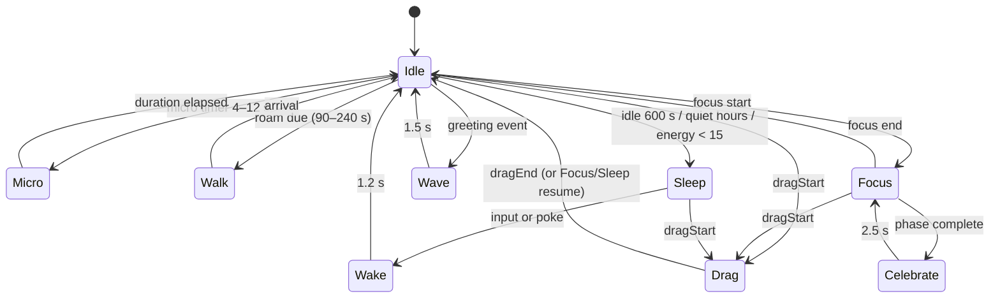

# Behavior Engine

| Field | Value |
| --- | --- |
| Status | Approved for build |
| Version | 1.0 |
| Date | 2026-10-19 |
| Related | [Animation system](animation-system.md) · [Rive contract](../03-design/rive-authoring-contract.md) · [Requirements](../01-product/requirements.md) |

The behavior engine is Mochi's "brain": a deterministic, pure-TypeScript director that decides what the pet is doing, when it sleeps, whether it roams, and how its mood evolves. It runs in the main process at 2 Hz. It does not know about Electron, Rive, windows, or React; its only outputs are decisions.

## 1. Design principles

1. **Alive, not random.** Variation comes from context and history, not a uniform random pick every tick. Mochi should feel like it has a routine.
2. **Never punishing.** Low energy means a nap; a missed day means nothing; there is no death, decay spiral, or lost streak for absence.
3. **Interruptible.** The user's touch always wins. A forced behavior (drag, poke, focus) preempts scheduled behavior immediately.
4. **Deterministic.** Given the same clock, seed, and event sequence, decisions are identical. This makes the pet testable.
5. **Bounded.** Every behavior has a maximum duration and a watchdog. There is no state from which the pet cannot recover.
6. **Quiet by default.** The engine prefers subtle motion and silence. Bubble copy is a separate, rate-limited concern.

## 2. Two layers: mode and behavior

### 2.1 Modes (macro-state)

| Mode | Meaning | Entered by | Leaves to |
| --- | --- | --- | --- |
| `boot` | Asset/window loading | App start | `awake` |
| `awake` | Default daytime state | Boot, wake, focus end, break end | `focus`, `sleep`, `dragged`, `hidden` |
| `focus` | A focus phase is active | Focus start/resume | `awake` on pause/stop/complete |
| `sleep` | Resting | Idle ≥ 600 s, quiet hours, energy < 15 | `awake` on input/poke |
| `dragged` | User is moving the window | Drag start | Previous mode on drop |
| `hidden` | Pet window hidden | Tray/hotkey | Previous mode on show |
| `suspended` | System sleep/lock | Power event | Previous mode on resume |

Focus is a **mode**, not a behavior, because it suppresses roaming, sleep, and unsolicited bubbles. A focus *break* is `awake` with `focus.phase = 'break'`, so Mochi can stretch and wander during the break.

### 2.2 Behaviors (micro-state)

A behavior is a time-bounded activity played by the Rive state machine. Behaviors do not overlap; layers inside Rive may (breathing + blinking + face).



The diagram shows the common path. The authoritative transition table is in [§4](#4-priority-and-preemption).

## 3. Behavior catalog

| ID | Rive state | Duration | Base weight | Cooldown | Eligible when | Priority | Interruptible |
| --- | --- | --- | --- | --- | --- | --- | --- |
| `idle` | `idle` | indefinite | — | — | Always (base) | P4 | Yes |
| `look_left` | `idle` (look layer) | 1.4–2.2 s | 14 | 20 s | Awake, not focused | P4 | Yes |
| `look_right` | `idle` (look layer) | 1.4–2.2 s | 14 | 20 s | Awake, not focused | P4 | Yes |
| `ear_flick` | `idle` (ear layer) | 0.6 s | 10 | 45 s | Awake | P4 | Yes |
| `sit` | `idle` (sit variant) | 6–12 s | 8 | 3 min | Energy < 60, awake | P4 | Yes |
| `stretch` | `idle` (stretch clip) | 2.4 s | 12 | 90 s | Awake, energy > 30 | P3 | Yes |
| `yawn` | `idle` (yawn clip) | 1.8 s | 6 | 5 min | Energy < 45 or hour ≥ 21 | P3 | Yes |
| `walk` | `walk` | 2–6 s | 10 | 90–240 s | Awake, roamScope ≠ stationary, energy > 25 | P3 | Yes |
| `sleep` | `sleep` | until wake | — | — | Idle ≥ 600 s, quiet hours, energy < 15 | P2 | Yes (input) |
| `wake` | `wake` | 1.2 s | — | 30 s | Leaving sleep | P2 | Yes |
| `wave` | `wave` | 1.5 s | — | 45 min | Greeting event, level-up | P2 | Yes |
| `focus` | `focus` | until phase change | — | — | Focus mode active | P1 | Yes (drag) |
| `celebrate` | `celebrate` | 2.5 s | — | 10 s | Phase complete, level-up | P1 | Yes (drag) |
| `drag` | `drag` | until drop | — | — | Dragging | P0 | No |
| `nudge` | `focus` (look-up variant) | 2 s | — | 1 per 10 min | Focus active, drift signal | P1 | Yes |

**Blink and breathe are not director behaviors.** They live inside the Rive state machine so they remain organic during any state, including focus and sleep. The director never schedules a blink; it would look mechanical.

### 3.1 Behavior definition type

```ts
interface BehaviorSpec {
  id: BehaviorId;
  riveState: RiveState;
  minDurationMs: number;
  maxDurationMs: number | null;   // null = until interrupted
  baseWeight: number;
  cooldownMs: number;
  priority: 0 | 1 | 2 | 3 | 4;
  interruptible: boolean;
  eligible(ctx: BehaviorContext): boolean;
  onStart?(ctx: BehaviorContext): PetEffect[];
  onEnd?(ctx: BehaviorContext): PetEffect[];
}
```

`onStart`/`onEnd` return **effects** (`addMood`, `addXp`, `scheduleBubble`) that are applied by the application layer. The domain never writes to storage directly.

## 4. Priority and preemption

| Priority | Meaning | Examples | Can interrupt |
| --- | --- | --- | --- |
| P0 | Direct manipulation | Drag | Everything, immediately |
| P1 | Session-critical | Focus posture, celebrate, nudge | P2–P4, except a non-interruptible P0 |
| P2 | Social/greeting | Wave, wake, sleep | P3–P4 |
| P3 | Scheduled motion | Walk, stretch, yawn | P4 |
| P4 | Ambient idle | Look, ear flick, sit, breathe | Nothing |

Rules:

- `request(behavior, priority)` preempts the current behavior if `priority < current.priority` (lower number = higher priority) **or** the current behavior is interruptible and the new priority is equal.
- A P0 drag cannot be preempted. On drop, the engine restores the mode that was active before the drag (`focus`, `sleep`, or `awake`).
- Sleep is P2 but has a special rule: it is entered only after the idle timer, and it is interrupted by any input, poke, focus start, or drag.
- Celebrate cannot interrupt another celebrate within 10 s; the event is coalesced.
- Nudge is allowed once per 10 minutes per focus phase and is suppressed if the user has interacted in the last 5 minutes.
- A forced behavior from the debug hook bypasses scoring but still respects P0.

### 4.1 Stuck-state watchdog

Every selected behavior gets a deadline `startedAt + maxDuration + 2 s` (for indefinite behaviors, 30 min). If the deadline passes without an end event, the director:

1. Logs `behavior_timeout` with the behavior id and elapsed time.
2. Forces `wake` (if sleeping) or `idle`.
3. Increments a diagnostics counter; three timeouts in 10 minutes trigger the static fallback and a visible "animation paused" tooltip.

The Rive bridge separately reports whether the requested state was acknowledged. If not acknowledged within 2 s, it retries once, then reports an animation fault to main.

## 5. Selection algorithm

Every 500 ms, `BehaviorDirector.tick(ctx)` runs:

```
if current is indefinite and mode unchanged: return
if current has time remaining: return
candidates = catalog.filter(eligible(ctx) && cooldownReady && not in recent[0..2])
for each candidate:
    score = baseWeight
          × modeFactor(candidate, ctx)
          × energyFactor(candidate, ctx)
          × moodFactor(candidate, ctx)
          × circadianFactor(candidate, ctx)
          × recencyFactor(candidate, ctx)
    # jitter ±10% from seeded RNG to avoid a metronome feel
decision = weightedPick(candidates, rng)
```

### 5.1 Factors

| Factor | Effect |
| --- | --- |
| **Mode** | Focus: only focus/nudge/celebrate/drag are eligible. Sleep: none except wake/drag. Break: stretch/walk get ×2, look gets ×0.5. |
| **Energy** | Walk requires > 25 and gets ×0.5 below 40. Stretch ×0 below 20. Sit ×2 below 40. Sleep becomes mandatory below 15. |
| **Mood** | Below 35: look/sit up, walk/playful down. Above 70: walk/celebrate up, stretch up. Mood never gates function. |
| **Circadian** | 21:00–22:00: yawn/sit up, walk down. 22:00–07:00 (default quiet hours): sleep forced after 5 min idle. 07:00–10:00: wave/look up. |
| **Recency** | Last 3 behaviors get ×0.1; the immediately previous behavior is excluded. |
| **Idle duration** | After 2 min of no input, micro intervals lengthen toward 12 s (calmer). After 8 min, sleep weight rises. |
| **Reduced motion** | Walk excluded; stretch/yawn allowed but no window movement; look amplitudes reduced by Rive. |

### 5.2 Timing

- **Micro timer:** after an idle gap of 4–12 s (seeded, energy/mood adjusted), one micro-behavior is selected. The gap is measured from the end of the previous behavior.
- **Roam timer:** 90–240 s after the last walk or app start, if eligible. A roam plan is 2–6 s long, at 60–90 DIP/s, within the roam band.
- **Sleep check:** every tick; sleeps when `userInputIdle ≥ 600 s`, or quiet hours with ≥ 5 min idle, or energy < 15.
- **Wake check:** on any user input event (pointer, keyboard via idle-state transition, drag, focus start). We do not install global input hooks; `powerMonitor.getSystemIdleState` and pet-window interaction are the signals.

### 5.3 Inputs and effects

| Input event | Engine response |
| --- | --- |
| `app.started` | Mode `awake`; `wave` after first paint; schedule first micro in 3 s |
| `user.active` (idle < 60 s) | Reset idle timer; if sleeping, `wake` |
| `user.idle(600 s)` | Enter `sleep`; emit `pet:mood` no change; schedule Zzz |
| `focus.started` | Mode `focus`; cancel roam; behavior `focus`; suppress bubbles |
| `focus.paused` / `focus.stopped` | Return to `awake`; stretch after 2 s |
| `focus.breakStarted` | Mode `awake` with break context; stretch/walk weights up |
| `focus.phaseCompleted` | `celebrate` P1 for 2.5 s, then return to phase mode |
| `pet.poked` | If sleeping → `wake`; else happy micro-reaction; mood +1 (capped) |
| `pet.dragStarted` | Mode `dragged`; cancel current; P0 |
| `pet.dragEnded` | Restore prior mode; settle behavior; mood unchanged |
| `pet.hoverStarted` | Optional look-toward-cursor, handled in Rive; no director change |
| `display.changed` | Recompute roam band; cancel in-flight walk |
| `power.suspend` | Mode `suspended`; do not accrue awake time |
| `power.resume` | Mode `awake`; wake behavior; reset idle timer |
| `level.up` | `wave` (P1) + bubble; celebrate after |
| `quietHours.entered` | If idle ≥ 5 min, sleep; otherwise yawn/sit bias |

## 6. Energy, mood, and progress

### 6.1 Energy

- Range 0–100, float internally, rounded for display. Start at 80.
- **Awake drain:** 1 point per 10 minutes (6/hour), paused during `suspended`, `hidden`, and `dragged`. Focus does not add extra drain; breaks are encouraged by mood, not energy punishment.
- **Sleep recovery:** 1 point per 4 minutes (15/hour), capped at 100.
- **Offline:** elapsed time up to 12 h is treated as sleep recovery at 4 points/hour, then clamped. No negative offline effects.
- **Thresholds:** < 40 biases sitting/quiet behaviors; < 25 disables roaming; < 15 forces sleep until energy ≥ 30.
- **Low-energy hysteresis:** if sleep was forced by energy < 15, an explicit user click or focus start may wake Mochi, but forced sleep is suppressed for 5 minutes so it does not immediately collapse again. Energy below 15 still biases sitting and slows idle; it never blocks the timer or Den.
- **No purchase or interaction can restore energy.** Petting improves mood, not energy; this avoids a grind loop.

### 6.2 Mood

- Range 0–100, start 70, floor 20 (never zero; avoids a "dying pet" dynamic).
- **+1** per poke, cap +8 per local day.
- **+6** per completed focus phase (not per minute).
- **+3** per break taken after a focus phase.
- **+2** per level-up.
- **−1** per 6 h of awake neglect (no interaction, no focus), capped at −4 per day.
- **−4** per 24 h offline, capped at −4 total (no compounding).
- Mood influences behavior weights and bubble tone; it never blocks features.

### 6.3 XP and levels

- **1 XP per completed focus minute**, awarded at phase completion.
- **+5** per completed focus phase; **+2** per break completed.
- **+3** for the first app open of the local day.
- Partial sessions ≥ 50% award prorated XP but do not count as a completed session or extend the streak.
- Level threshold: `xpForLevel(n) = 10 × (n − 1) × (n + 5)`, for `n ≥ 2`. Level 2 at 70 XP, level 5 at 450, level 10 at 1,350, cap 20.
- XP never decreases. Streaks never decrease retroactively; a missed day resets the current streak to 0 but preserves the longest streak.

### 6.4 Cosmetics unlocks

| Level | Unlock |
| --- | --- |
| 2 | Scarf colors: moss, sky |
| 3 | Round glasses (focus boost visual only) |
| 5 | Leaf hat |
| 7 | Bed accessory for sleep state |
| 10 | Aurora scarf (subtle gradient) |
| 14 | Tiny mug (break state) |

Cosmetics are cosmetic only; none affect timers, XP rate, or behavior eligibility.

## 7. Bubble policy

Bubble decisions belong to the behavior/application layer, not the renderer. The renderer only presents and dismisses.

| Rule | Value |
| --- | --- |
| Unsolicited minimum gap | 5 minutes |
| Unsolicited maximum | 6 per hour |
| Quiet hours | No unsolicited bubbles |
| Focus phase | Suppressed, except start confirmation and completion |
| Missed days | Never mentioned |
| Streak loss | Never mentioned |
| Copy length | ≤ 80 characters |
| Dismissal | 4–8 s, or on click/interaction |
| Actions | At most one primary action + dismiss |
| Screen reader | `role="status"`, announced once |

Copy is authored in `shared/copy/bubbles.ts`, grouped by context (`greeting`, `focus_start`, `focus_complete`, `break`, `sleepy`, `return`, `level_up`, `hover_hint`). Selection is seeded and avoids repeating the last 3 IDs. No generated or remote copy.

## 8. Persistence and restart

| State | Persisted | Notes |
| --- | --- | --- |
| Energy, mood, XP, level | Yes | Floats rounded to 2 decimals |
| Last seen timestamp | Yes | Drives offline accrual |
| Current mode | Partially: `sleep` vs `awake` | Never restore `dragged`, `hidden`, `suspended`, or `focus` from a stale crash |
| Behavior queue / recent list | No | Rebuilt; last 3 behavior IDs persisted only for anti-repetition |
| Cooldowns | No | Reset on start; acceptable because behavior is ambient |
| Bubble history | Last 3 IDs + last bubble time | Prevents repetition after restart |

On restart after a crash, Mochi wakes in `awake`, applies at most 12 h of offline recovery, and does not immediately celebrate or wave if the app was killed less than 2 minutes ago.

## 9. Determinism and testing

The director is constructed with `Clock`, `Rng`, and a read-only `BehaviorContext`. Tests use a fake clock and a seeded PRNG (`mulberry32`).

Required test suites:

1. **Eligibility table tests.** Every behavior × mode × energy band × quiet-hours combination asserts eligible/not.
2. **Priority tests.** A matrix of current/requested priorities asserts preemption and `interruptible` behavior.
3. **Sequence goldens.** Three scripted days (morning, focus-heavy, late night) produce stable behavior sequences for a fixed seed.
4. **Fuzz.** 10,000 random events (poke, drag, focus transitions, suspend, display change) never produce an unknown state, a stuck behavior, or an exception.
5. **Offline accrual.** Property tests: energy ∈ [0,100], mood ∈ [20,100], XP monotonic, level consistent with XP.
6. **Watchdog.** A behavior that never ends is force-reset within `maxDuration + 2 s`.

The director has no timers of its own; the application scheduler calls `tick`. This makes tests fast and deterministic.

## 10. Observability

In development, an overlay (toggled with `Ctrl+Shift+B`) shows: mode, behavior, priority, time in state, energy, mood, XP, next micro/roam deadline, idle seconds, and the last 5 decisions with scores. In production, only aggregate counters are kept locally: behavior histogram, timeouts, average idle gap, roams per day, pokes per day. No content or context is recorded.

## 11. Scenario walkthroughs

**Morning start.** 08:10, energy 78, mood 72. App starts, `boot` → `awake`, wave after first paint. First micro at 6 s (look left), then 9 s (ear flick). At 3 min, a short walk to the left. Focus starts at 08:20: roam cancels, `focus` posture, glasses appear. At 08:45, celebrate + toast + XP; break begins, stretch and a longer walk; mood +3 at break end.

**Afternoon slump.** 15:30, energy 26, mood 61. Walk is disabled; sit/look dominate. At energy 14, sleep begins even without 10 minutes idle; it wakes on the next click or focus start. No bubble says "you should rest."

**Late night.** 23:40, quiet hours. Mochi is asleep. The user opens the Den and starts a 50-minute session; focus start wakes it, `focus` posture suppresses quiet-hours sleep until the phase ends, then it yawns and sleeps. This respects user intent over schedule.

**Return after a week.** Offline recovery raises energy to 100, mood drops by 4 to 67. App starts in `awake`, waves only if it was not killed recently, and shows no guilt copy. Stats show the gap without a red warning.

**Dragged during focus.** P0 drag cancels focus posture; the timer continues. On drop, the engine restores `focus` and the pet settles into the posture within 300 ms.

---

**Next:** [Animation system →](animation-system.md)
