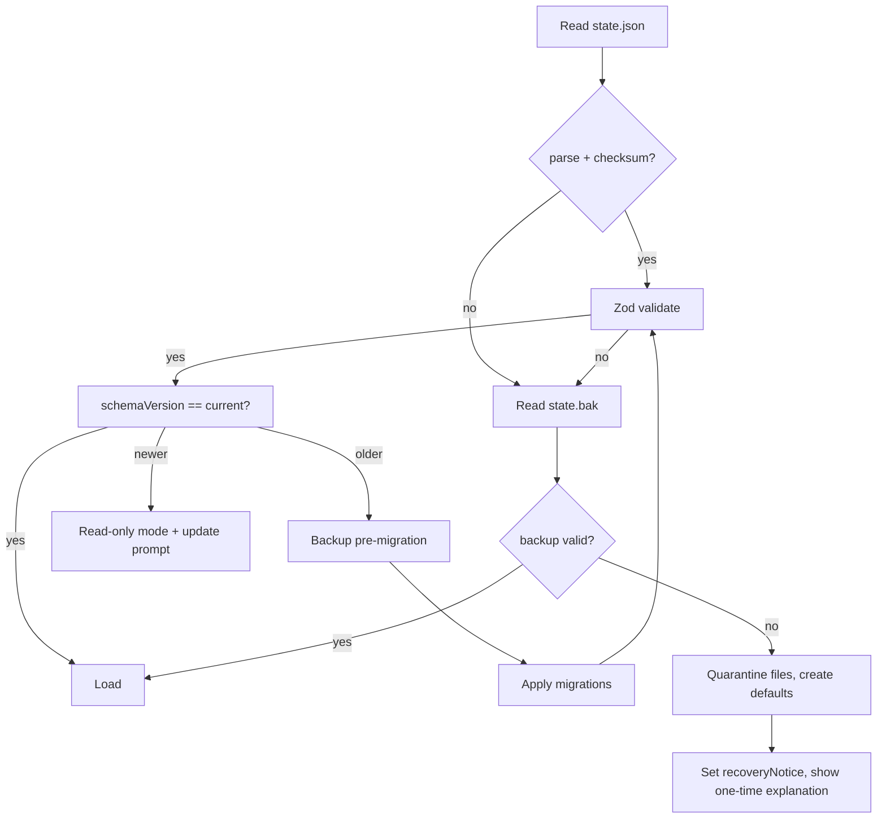

# Data and Persistence

| Field | Value |
| --- | --- |
| Status | Approved for build |
| Version | 1.0 |
| Date | 2026-10-19 |
| Related | [Focus engine](focus-engine.md) · [Security & privacy](security-and-privacy.md) · [ADR-0007](../04-adr/0007-versioned-json-store.md) |

Mochi stores a small amount of local state: preferences, pet progress, focus configuration, daily aggregates, and placement. The design goal is **boring durability**: atomic writes, checksummed files, tested migrations, and a recovery path for every corruption case. There is no database server, no native module, and no network dependency.

## 1. Storage locations

| Path | Contents | Backed up | User-visible |
| --- | --- | --- | --- |
| `%APPDATA%\Mochi\state.json` | Primary state document | No (cloud) | Via export |
| `%APPDATA%\Mochi\state.bak` | Last known-good state | No | Via export |
| `%APPDATA%\Mochi\runtime.json` | Small active-session checkpoint (2 s cadence) | No | No |
| `%APPDATA%\Mochi\state.corrupt-<timestamp>.json` | Quarantined invalid state | No | Path shown in Settings |
| `%APPDATA%\Mochi\logs\` | Rotated diagnostic logs | No | Export |
| `%APPDATA%\Mochi\exports\` | User-requested exports | No | User-chosen folder |
| `%APPDATA%\Mochi\updates\` | electron-updater cache | No | No |

`app.getPath('userData')` resolves the base directory; the code must never hard-code a path. A portable build (`--portable`) uses `<exe-dir>/data` instead, subject to write permission; if the directory is not writable, it falls back to `%APPDATA%` and tells the user once.

All files are UTF-8 JSON. No secrets, tokens, or credentials are stored. Windows ACLs on `%APPDATA%` are the security boundary; the app does not create world-readable copies.

## 2. Document format

Every persisted document uses the same envelope:

```json
{
  "format": 1,
  "checksum": "sha256:1f0c…",
  "payload": {
    "schemaVersion": 1,
    "meta": { "...": "..." },
    "settings": { "...": "..." },
    "pet": { "...": "..." },
    "focus": { "...": "..." },
    "stats": { "...": "..." },
    "ui": { "...": "..." },
    "placement": { "...": "..." }
  }
}
```

- `format` is the envelope version (not the state schema).
- `checksum` is SHA-256 over a **canonical serialization** of `payload` (object keys sorted recursively, arrays preserved, numbers normalized via JSON).
- `schemaVersion` is the state schema version, migrated sequentially.
- Unknown top-level keys inside `payload` are preserved for forward compatibility? **No** — the loader rejects unknown keys in critical sections (`pet`, `focus`, `stats`) to catch corruption, but ignores unknown keys in `ui` and `meta` for forward compatibility. This is validated by Zod (`.strict()` on critical objects, `.passthrough()` on `ui`/`meta`).

## 3. State schema (v1)

### 3.1 Example

```json
{
  "schemaVersion": 1,
  "meta": {
    "installId": "5b6f0f9a-2c3e-4b1e-9f4a-9b7f0f0b6a11",
    "createdAt": "2026-10-19T18:04:11.220Z",
    "lastSavedAt": "2026-10-19T18:42:03.881Z",
    "lastRunVersion": "1.0.0",
    "recoveryNotice": null
  },
  "settings": {
    "general": {
      "launchAtLogin": false,
      "theme": "system",
      "language": "en",
      "notifications": true,
      "sound": true,
      "volume": 0.6,
      "quietHours": { "enabled": true, "start": "22:00", "end": "07:00" },
      "reducedMotion": "system",
      "highContrast": false
    },
    "pet": {
      "name": "Mochi",
      "roamScope": "corner",
      "snapToCorners": true,
      "hideInFullscreen": false,
      "pauseWhenLocked": true
    },
    "focus": {
      "workMin": 25,
      "shortBreakMin": 5,
      "longBreakMin": 15,
      "rounds": 4,
      "autoStartBreak": true,
      "autoStartWork": false,
      "autoResumeAfterIdle": false,
      "idlePauseEnabled": true
    },
    "hotkeys": {
      "togglePet": "Control+Alt+P",
      "toggleFocus": "Control+Alt+F",
      "openDen": "Control+Alt+D"
    },
    "updates": { "channel": "stable", "autoCheck": true },
    "advanced": { "hardwareAcceleration": true }
  },
  "pet": {
    "energy": 80.0,
    "mood": 70.0,
    "xp": 0,
    "level": 1,
    "lastSeenAt": "2026-10-19T18:42:00.000Z",
    "lastInteractionAt": null,
    "lastMode": "awake",
    "recentBehaviors": ["look_left", "sit"],
    "lastBubble": { "id": "greeting_01", "at": "2026-10-19T18:05:00.000Z" },
    "cosmetics": { "equipped": "None", "unlocked": ["None"] },
    "dailyMoodGain": { "date": "2026-10-19", "value": 0 }
  },
  "placement": {
    "anchor": "bottom-right",
    "x": 1580,
    "y": 680,
    "display": {
      "id": "2528732444",
      "label": "DISPLAY1",
      "bounds": { "x": 0, "y": 0, "width": 1920, "height": 1080 },
      "scaleFactor": 1
    },
    "savedAt": "2026-10-19T18:30:00.000Z"
  },
  "focus": {
    "active": null,
    "recentSessions": []
  },
  "stats": {
    "days": {
      "2026-10-19": {
        "focusMs": 3000000,
        "workSessions": 2,
        "breaks": 1,
        "xp": 55,
        "pokes": 3
      }
    },
    "streak": { "current": 2, "longest": 5, "lastCompletedDate": "2026-10-19" }
  },
  "ui": {
    "denBounds": { "width": 1040, "height": 720, "x": 440, "y": 180 },
    "lastDenView": "home"
  }
}
```

### 3.2 Section rules

| Section | Validation | Notes |
| --- | --- | --- |
| `meta` | UUID installId, ISO timestamps | `installId` is random, not hardware-derived; `recoveryNotice` is a one-time message ID |
| `settings` | Strict; every field has a default and bounds | Invalid value → field default + warning, not whole-file rejection |
| `pet` | Strict; energy/mood 0–100, XP ≥ 0, level derived | Level is recomputed from XP on load; a mismatch is corrected silently |
| `focus` | Strict; active session shape; embedded config-snapshot bounds | Unknown phase enum → discard active session, keep history; the live focus config lives only in `settings.focus` |
| `stats` | Strict; date keys `YYYY-MM-DD`, numbers ≥ 0 | Future dates beyond +1 day are discarded as corrupt |
| `placement` | Loose; clamped later | Invalid placement → primary display corner |
| `ui` | Passthrough | Window bounds are clamped to a visible display |

`FocusView.config` sent to renderers is **derived**, never stored twice: it is the active session's immutable config snapshot when a session is running, otherwise the current `settings.focus`. `focus:setConfig` is the only writer for focus timings; `settings:update` rejects focus-timing keys. This avoids two writable copies that can diverge.

### 3.3 Settings inventory

Every setting has a UI control, a default, and a validation rule. This table is also the settings inventory test fixture.

| Key | Default | Bounds / values | Applies |
| --- | --- | --- | --- |
| `general.launchAtLogin` | false | boolean | Immediately |
| `general.theme` | `system` | `system \| light \| dark` | Immediately |
| `general.language` | `en` | BCP-47 (v1: `en`) | Restart (v1) |
| `general.notifications` | true | boolean | Immediately |
| `general.sound` | true | boolean | Immediately |
| `general.volume` | 0.6 | 0–1 | Immediately |
| `general.quietHours.enabled` | true | boolean | Immediately |
| `general.quietHours.start/end` | 22:00 / 07:00 | `HH:mm`, 24h | Immediately |
| `general.reducedMotion` | `system` | `system \| on \| off` | Immediately |
| `general.highContrast` | false | boolean | Immediately |
| `pet.name` | `Mochi` | 1–20 grapheme clusters, trimmed | Immediately |
| `pet.roamScope` | `corner` | `corner \| wander \| stationary` | Immediately |
| `pet.snapToCorners` | true | boolean | Immediately |
| `pet.hideInFullscreen` | false | boolean | Immediately |
| `pet.pauseWhenLocked` | true | boolean | Immediately |
| `focus.workMin` | 25 | 5–120 | Next phase |
| `focus.shortBreakMin` | 5 | 1–30 | Next phase |
| `focus.longBreakMin` | 15 | 5–60 | Next phase |
| `focus.rounds` | 4 | 2–8 | Next session |
| `focus.autoStartBreak` | true | boolean | Next phase |
| `focus.autoStartWork` | false | boolean | Next phase |
| `focus.autoResumeAfterIdle` | false | boolean | Immediately |
| `focus.idlePauseEnabled` | true | boolean | Immediately |
| `hotkeys.*` | see above | Valid accelerator or empty | Immediately (re-register) |
| `updates.channel` | `stable` | `stable \| beta` | Next check |
| `updates.autoCheck` | true | boolean | Immediately |
| `advanced.hardwareAcceleration` | true | boolean | Restart |

## 4. Atomic write protocol

Writes are serialized through a single `PersistenceQueue` in main. There is no concurrent writer (single-instance app), and no renderer ever writes files.

### 4.1 Normal write

1. Serialize canonical `payload`, compute checksum, wrap in envelope.
2. Write to a unique temp file in the same directory: `state.json.tmp-<pid>-<counter>` using `wx` (fail if it exists), then `fsync` the file handle.
3. Copy the current `state.json` to `state.bak.tmp` (if the primary exists and is valid), `fsync`, then rename to `state.bak`. Keep one backup; the previous backup is replaced.
4. Rename the temp file to `state.json` (atomic replace on Windows via `MoveFileEx` semantics). Retry up to 3 times with 25/50/100 ms backoff on `EPERM`/`EBUSY` (antivirus/indexer locks).
5. Update in-memory `meta.lastSavedAt` only after success.
6. On failure, log and retry on the next debounce; never truncate the primary.

If step 3 fails, the write still proceeds; a stale backup is better than blocking. If step 4 fails, the temp file is removed on the next cleanup and the previous primary remains valid.

### 4.2 Scheduling

| Trigger | Behavior |
| --- | --- |
| Any settings/state change | Debounce 500 ms, max delay 2 s |
| Focus command (start/pause/resume/stop/skip) | Flush immediately (await, with a 750 ms timeout) |
| Focus running | Checkpoint `runtime.json` every 2 s (small file, §4.4) |
| App hide-to-tray | Flush |
| `suspend` / `query-session-end` | Best-effort synchronous flush (`writeFileSync` + rename), 250 ms budget |
| `before-quit` | Await queue drain, max 1 s |
| Update install | Flush before quit |

Writes are coalesced: if three changes arrive within the debounce window, one write contains all three. The queue holds at most one pending snapshot; an in-flight write completes before the next starts.

### 4.3 Checksums and canonical serialization

The checksum catches truncation, partial writes, and most bit rot that still parses as JSON. It is not a security signature; local attackers with write access to `%APPDATA%` already control the app's data. The checksum exists for integrity, not authenticity.

### 4.4 Runtime checkpoint

`runtime.json` is a separate, tiny document:

```json
{
  "format": 1,
  "sessionId": "…",
  "phase": "work",
  "status": "running",
  "remainingMs": 842000,
  "lastTickWallMs": 1760899323000,
  "phaseCompletionAwarded": false
}
```

- Written every **2 s** while a phase is running, and immediately on pause/resume/stop.
- No checksum (atomic rename is sufficient; a torn checkpoint is discarded and the full state is used).
- On startup, if `runtime.json` exists and matches `focus.active.id`, use it to restore the remaining time (tolerance ± 2 s).
- It is deleted on phase completion, stop, or a clean quit with no active session.
- Typical size < 200 bytes; 2 s cadence is negligible disk wear.

## 5. Load, validate, and recover



### 5.1 Rules

1. **Validate before apply.** A file that fails checksum, parse, or Zod never reaches the domain.
2. **Field-level fallback.** For settings, an invalid field is replaced by its default and a warning is logged; the rest of the file is kept. For `pet`/`focus`/`stats`, structural corruption triggers the backup path.
3. **Backup, then migrate.** Before any migration, copy the current file to `state.pre-v<n>.bak` (one retained). If migration throws, restore the copy and start in recovery mode.
4. **No silent data loss.** When both primary and backup fail, move them to `state.corrupt-<timestamp>.json` (never delete), create a fresh default state, and set `meta.recoveryNotice = 'state_recovered'`. The Den shows a one-time, dismissible explanation with the folder path and an "Open folder" button.
5. **Newer schema.** If `schemaVersion > current`, do not write the file. Run in read-only compatibility mode: the pet works with defaults, focus history is displayed read-only, and Settings shows "Update Mochi to save changes." This prevents a downgrade from destroying data.
6. **Derived values.** `level` is recomputed from XP; `streak` is recomputed from `stats.days` when inconsistent; daily aggregates are never trusted for level.

## 6. Migrations

- `MIGRATIONS` is an ordered map keyed by target version: `{ 2: v1ToV2, 3: v2ToV3, … }`.
- Each migration is a pure function `(payload: unknown) => unknown` with unit tests and a fixture for every historical version.
- Migrations run sequentially from the file's version to the current version, in one transaction-like pass: mutate a clone, validate against the current schema, then write.
- Migrations must be **idempotent in effect**: running a migration twice on an already-migrated payload is a no-op (tested).
- Never delete data in a migration unless it is provably invalid or a documented retention rule; deprecate fields by moving them to `meta.legacy` for one release.
- Fixtures live in `tests/fixtures/state/v1.json`, `v2.json`, etc. CI fails if a new schema version has no fixture and migration test.

Schema version 1 is the initial release; the migration machinery is built now so v1.1 does not improvise.

## 7. Statistics model

### 7.1 Daily aggregates

`stats.days[YYYY-MM-DD] = { focusMs, workSessions, breaks, xp, pokes }`

- Only completed phases contribute `focusMs`; the split at midnight is handled by the focus engine's segments.
- `workSessions` increments on completed work phases (not partial).
- `breaks` increments on completed breaks (not skipped).
- `xp` is the XP awarded that day, including daily-open and level bonuses.
- `pokes` is capped by the daily mood cap but recorded for local diagnostics.
- Entries with all-zero values older than 2 years are pruned on load; non-zero history is retained.

### 7.2 Streak

- `current`: consecutive local days with ≥ 1 completed work phase, ending today or yesterday. If the last completed date is older than yesterday, current is 0.
- `longest`: max observed current, never decreases.
- Recomputed lazily on read and after completion; no timer at midnight.

### 7.3 Recent sessions

`focus.recentSessions` keeps the last 30 summaries (completed or stopped), each < 200 bytes. The full history is the daily aggregate; sessions are for the "Recent" list, not analytics.

## 8. Diagnostics and event log

- `logs/main.log` and `logs/pet.log` via electron-log, rotated at 5 MB with 7 files.
- A separate `events.jsonl` is optional and disabled unless diagnostics mode is on. When enabled, it stores 30 days / 5 MB, one event per line.
- No window titles, app names, file contents, keystrokes, or clipboard data. Event properties are IDs, enums, durations, and counts.
- Event names (exhaustive list for v1): `app_started`, `app_quit`, `pet_poked`, `pet_dragged`, `pet_slept`, `pet_woke`, `focus_started`, `focus_paused` (reason), `focus_resumed`, `focus_completed`, `focus_stopped` (partial bool), `break_completed`, `settings_changed` (key only), `update_checked`, `update_failed`, `animation_fault`, `renderer_crash`, `behavior_timeout`, `state_recovered`.
- Export preview shows the exact JSON/log bundle before saving. Upload is not implemented in v1; the user can share the file manually ([ADR-0009](../04-adr/0009-privacy-first-observability.md)).

## 9. Export, import, and reset

| Action | Behavior |
| --- | --- |
| **Export data** | Save dialog → `mochi-export-YYYYMMDD-HHmm.json` containing envelope + app version + OS version. Includes `installId`; the preview marks it. No logs unless "include diagnostics" is checked. |
| **Export diagnostics** | JSON + last 3 logs, with a preview and a size cap (5 MB). No automatic upload. |
| **Import** | Not in v1. The export format is versioned to allow a future import with validation. |
| **Reset progress** | Confirmation dialog; options: keep settings (default) / reset everything. Deletes pet/stats/focus history, preserves `settings`. Writes a fresh state atomically, quarantines the old file as `state.reset-<timestamp>.json`. |
| **Uninstall** | Uninstaller offers "Keep my Mochi data" (default) or delete the data directory. Login item is always removed. |

## 10. Security and privacy properties

- No secrets stored; no encryption at rest (the data is not sensitive beyond usage counts, and Windows user-profile ACLs apply).
- `installId` is a random UUID, not a hardware fingerprint.
- Export paths are chosen via the native save dialog in main; renderers cannot specify arbitrary paths.
- Temp files are created with `wx` and cleaned on startup if older than 1 hour.
- Logs redact `%APPDATA%` to `%APPDATA%`? No: paths are useful for support. The username inside a path is minimized to `<user>` in exported diagnostics.
- Deletion is best-effort secure: normal file delete, no secure-erase claim on SSDs.

## 11. Capacity and performance

| Metric | Value |
| --- | --- |
| Typical `state.json` size | 8–40 KB after a year (daily entries dominate) |
| Worst-case size | < 250 KB with 3 years of history and 30 recent sessions |
| `runtime.json` writes | 1 per 2 s only while a focus phase runs |
| Full-state writes | ≤ 2/s worst case, typically a few per minute |
| Load time | < 15 ms for 250 KB on the reference machine |
| Event log | 5 MB cap, 30-day retention |

## 12. Testing

1. **Atomicity.** Fault-inject `rename`/`fsync` failures at each step; the previous state must remain loadable.
2. **Checksum.** Flip a byte in the payload; loader rejects and falls back.
3. **Truncation.** Truncate at every 1 KB boundary; no crash, recovery path chosen.
4. **Migration.** Fixtures for every schema version; idempotence; rollback on thrown migration.
5. **Newer schema.** Read-only mode; no writes; clear message.
6. **Field validation.** Fuzz 10,000 malformed settings values; defaults applied, no crash.
7. **Queue.** 1,000 rapid changes produce bounded writes and a final consistent state.
8. **Checkpoint recovery.** Kill at 2 s boundaries; restored remaining within ± 2 s.
9. **Dates.** Midnight/DST fixtures shared with the focus engine.
10. **Reset/export.** No secrets, valid JSON, correct filename, user cancel is a no-op.

All persistence tests use a temporary directory and a fake clock; they do not touch the real `%APPDATA%`.

## 13. Data inventory (summary)

| Data | Why | Retention | Personal? |
| --- | --- | --- | --- |
| Settings | User preferences | Until reset/uninstall | No |
| Pet energy/mood/XP | Companion continuity | Until reset/uninstall | No |
| Focus sessions and daily aggregates | User-facing stats | Aggregates indefinite; raw recent 30 | No |
| Placement / display signature | Remember where the pet lives | Until reset/uninstall | Quasi (monitor layout) |
| `installId` | Correlate a user's own exports | Until reset/uninstall | Random, not linkable |
| Logs / events | Diagnose crashes locally | 30 days / 5 MB | No content, paths minimized |

The full privacy posture is in [Security & privacy](security-and-privacy.md#62-data-inventory).

---

**Next:** [IPC contracts →](ipc-contracts.md)
