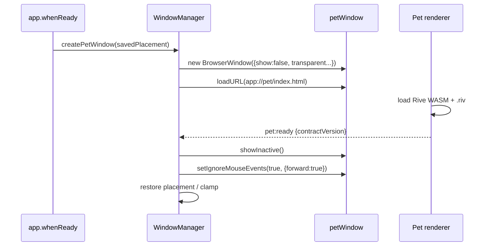
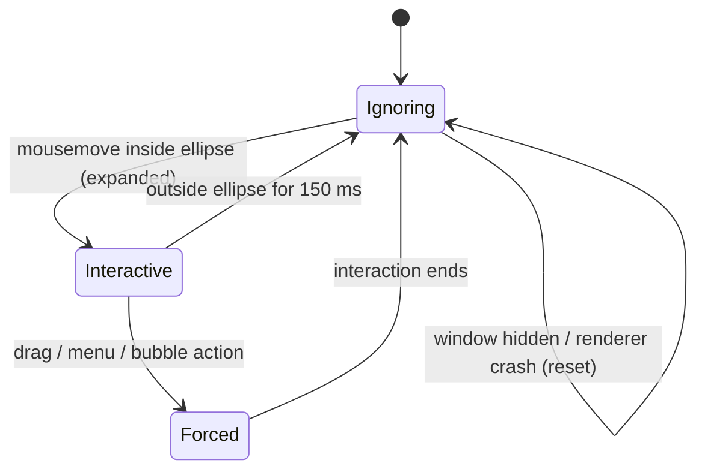
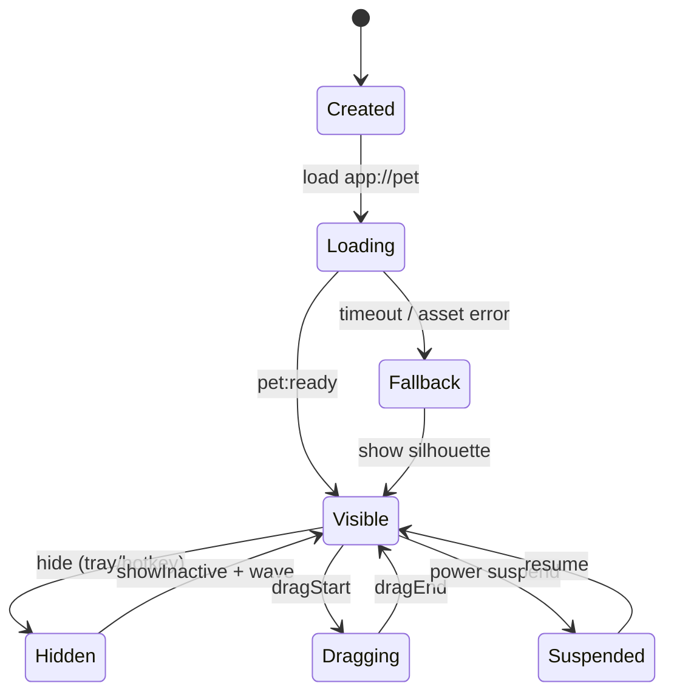

# Desktop Shell and Windows Integration

| Field | Value |
| --- | --- |
| Status | Approved for build; validate in Spike S1 |
| Version | 1.0 |
| Date | 2026-10-19 |
| Related | [Requirements](../01-product/requirements.md) · [Architecture overview](overview.md) · [ADR-0005](../04-adr/0005-transparent-roaming-window.md) · [ADR-0006](../04-adr/0006-click-through-hit-testing.md) |

This document specifies how Mochi behaves as a Windows citizen: window creation, transparency, click-through, dragging, roaming, multi-monitor/DPI handling, tray, hotkeys, power events, and the platform constraints we accept. It is deliberately implementation-level; the goal is that two engineers would build the same shell from it.

## 1. Window topology

| Window | Purpose | Lifetime | Frame | Transparent | Resizable | Taskbar | Always on top |
| --- | --- | --- | --- | --- | --- | --- | --- |
| `petWindow` | The character, bubble, and pointer surface | App lifetime | Frameless | Yes | No | Hidden | Yes (`screen-saver`) |
| `denWindow` | Timer, insights, settings, locker | Created lazily, hidden on close | Custom title bar with native controls | No | Yes (min 880×600) | Shown | No |
| `tray` | Native menu and status | App lifetime | — | — | — | Notification area | — |

There is no full-screen overlay. A full-width transparent always-on-top window would be simpler for movement but increases the blast radius of click-through bugs, interferes with fullscreen apps, and makes per-pixel hit testing mandatory. The tight window is the product-safe choice; the motion driver exists to make it feel seamless. See [ADR-0005](../04-adr/0005-transparent-roaming-window.md).

### 1.1 Pet window options

```ts
const petWindow = new BrowserWindow({
  width: 320,
  height: 360,
  x, y,                                  // restored, clamped to workArea
  show: false,
  frame: false,
  transparent: true,
  backgroundColor: '#00000000',
  hasShadow: false,
  resizable: false,
  movable: true,
  minimizable: false,
  maximizable: false,
  fullscreenable: false,
  closable: false,                       // quit only via tray / app lifecycle
  skipTaskbar: true,
  alwaysOnTop: true,
  focusable: false,          // never take keyboard focus from the user's app
  webPreferences: {
    preload: join(__dirname, '../preload/pet.js'),
    contextIsolation: true,
    sandbox: true,
    nodeIntegration: false,
    backgroundThrottling: false,         // the pet window is never focused
    devTools: isDev,
    spellcheck: false,
  },
});
petWindow.setAlwaysOnTop(true, 'screen-saver');
petWindow.setMenu(null);
```

Rules:

- **Never call `setVisibleOnAllWorkspaces` on Windows.** Electron documents it as unsupported (returns false / always false); the pet belongs to the virtual desktop it was launched on.
- **Do not use `-webkit-app-region: drag` for the pet.** It swallows click/hover events and prevents petting. Drag is implemented manually (§4).
- **Do not use CSS `backdrop-filter` expecting desktop blur.** It only blurs the window's own content. The bubble uses a near-opaque warm surface instead.
- **Do not set `resizable: true`.** Transparent windows are not reliably resizable on Windows and can lose transparency.
- **Show with `showInactive()`**, never `show()`/`focus()`, except when the user explicitly opens the Den.
- **The pet window is non-focusable** (`focusable:false`, which also implies skip-taskbar on Windows). Clicking the pet must not move the caret out of the user's editor. The Den is a separate focusable window; opening it is an explicit user action.
- **Set `app.setAppUserModelId('com.mochipet.desktop')` before creating windows** so Windows toasts attribute correctly.

### 1.2 Pet layout

```
┌──────────────────────────────┐ 320 × 360 DIP window, transparent
│                              │
│        ┌──────────────┐      │  bubble: 272 × 96, bottom at y=104
│        │   bubble     │      │  (HTML, not part of the Rive canvas)
│        └──────────────┘      │
│                              │
│          ╭────────╮          │  pet art: 200 × 220, anchored bottom-center
│          │ Mochi  │          │  at (60, 132)
│          ╰────────╯          │
│                              │  shadow ellipse: CSS, 120 × 18 at y=340
└──────────────────────────────┘
```

- The Rive canvas fills `200 × 220` DIP and uses `Layout({ fit: 'contain', alignment: 'bottomCenter' })`.
- The bubble overlays the top region and is `pointer-events: none` unless it has an action; when it has an action, only the action area becomes interactive.
- The window's transparent margins exist for the bubble, drag overshoot, and the drop shadow. They are click-through.
- Device pixel ratio is handled by Rive's resize hook; the canvas backing store is capped at DPR 2 to bound GPU cost on 4K displays.

### 1.3 Den window options

```ts
const denWindow = new BrowserWindow({
  width: 1040,
  height: 720,
  minWidth: 880,
  minHeight: 600,
  show: false,
  backgroundColor: '#F7F3EC',
  titleBarStyle: 'hidden',
  titleBarOverlay: { color: '#F7F3EC', symbolColor: '#2A2622', height: 40 },
  webPreferences: {
    preload: join(__dirname, '../preload/den.js'),
    contextIsolation: true,
    sandbox: true,
    nodeIntegration: false,
  },
});
```

- Closing the Den hides it (`event.preventDefault()`), preserving form state; quitting is explicit.
- The Den is created on first open (lazy), then reused. Cold open target is 1.2 s; warm open target is 300 ms.
- It remembers size/position across sessions but re-centers if the saved display is gone.
- The title bar overlay uses native Windows controls; the draggable region is a 40 px header with `-webkit-app-region: drag`, and all interactive controls are `no-drag`.

## 2. Transparency

`transparent: true` plus a fully transparent `backgroundColor` is required; the page must also set `html, body { background: transparent; }`. The pet canvas clears to alpha 0. CSS shadows are drawn inside the window and are clipped by its bounds, so the drop shadow is small and inset.

### What works

- Per-pixel alpha compositing over any desktop background.
- Rive vector rendering with antialiasing inside the alpha canvas.
- Rounded character silhouettes with no rectangular halo.
- Click-through over transparent pixels via the OS-level ignore toggle (§3).

### Known constraints and mitigations

| Constraint | Impact | Mitigation |
| --- | --- | --- |
| DevTools disables window transparency | Visual QA in DevTools is misleading | Visual QA always uses a packaged build or a detached DevTools window; document in test plan |
| Transparent windows cannot be resized | Window must stay fixed-size | Pet window is fixed 320×360; scale is an art/layout concern, not a window resize |
| No native shadow | Pet can look pasted on | Soft CSS ellipse + Rive contact shadow; no reliance on DWM shadow |
| GPU driver artifacts (black/gray frames, stale textures) | Pet may flash or show a rectangle | Compatibility mode disables hardware acceleration and relaunches; S1 evaluates vendor-specific workarounds |
| RDP / virtual machines may not composite alpha | Rectangle or black background | Detect via `process.env.SESSIONNAME`/GPU info only as a diagnostic; show a one-time "compatibility mode" suggestion |
| Windows high-contrast mode does not recolor canvas art | Character may not meet contrast | Bubble/Den follow theme; high-contrast setting adds an outline and text status; Rive art includes a high-contrast outline variant if feasible |
| DevTools/`ready-to-show` timing | Flash of white/black on launch | `show:false`; load, wait one animation frame after Rive `artboard` load, then `showInactive()` |

### Launch sequence



If the renderer does not report ready within 3 s, the window is shown anyway with the fallback silhouette (never leave the user with an invisible app). If it reports a contract mismatch, the same fallback applies and the error is logged.

## 3. Click-through and hit testing

The pet window is **click-through by default**. The OS-level state is `setIgnoreMouseEvents(true, { forward: true })`, which lets Chromium receive `mousemove` messages without intercepting clicks. When the cursor is over an interactive region, the renderer asks main to disable ignoring; when it leaves, main restores it.

### 3.1 Interactive regions

| Region | Geometry | Notes |
| --- | --- | --- |
| Pet body | Ellipse 168 × 200 DIP centered at (160, 242) | Expanded by `HIT_HYSTERESIS` (8 DIP) for entering; exit uses the unexpanded ellipse plus a 150 ms grace |
| Bubble | Its rendered rect (max 272 × 96), only when it contains an action | A non-action bubble is `pointer-events: none` |
| Context menu | Native menu, no region needed | Window is forced interactive while the menu is open |

The ellipse is a deliberate simplification. Per-pixel alpha sampling (`getImageData`/`readPixels`) every frame is expensive on a transparent GPU canvas and defeats the idle budget. The pet's silhouette is within the ellipse for all core states; state-specific offsets are listed in the [Rive contract](../03-design/rive-authoring-contract.md#6-hit-regions). If a state leans far outside the ellipse, the designer updates the offset table, not the renderer.

### 3.2 Toggle protocol



Rules:

1. Only `mousemove` is forwarded while ignoring. Coordinates are window-local CSS pixels (equal to DIP at zoom 1).
2. Entering: toggle `interactive` immediately (no 150 ms delay). Leaving: wait `INTERACTIVE_EXIT_DELAY` to survive jitter at the edge.
3. There is a maximum of one IPC toggle per 50 ms. The renderer keeps a local `interactive` flag and does not spam main.
4. While a drag or native context menu is active, the window is forced interactive regardless of the cursor.
5. On renderer crash, hide, or app suspend, main forces ignoring and clears the flag.
6. If main has been interactive for > 2 s without any `mousemove`, it samples `screen.getCursorScreenPoint()` at 10 Hz as a watchdog; this covers lost mouse-leave messages at screen edges.

### 3.3 The fast-click race

A click that arrives in the same frame as the first `mousemove` can pass through before main disables ignoring. This is inherent to the forwarded-event approach. Mitigations:

- The interactive zone is expanded by 8 DIP, so the toggle normally happens before the pointer reaches the visual silhouette.
- The toggle is sent on the first inside `mousemove`, not on a timer.
- E2E measures "first-click success" by moving at 800 DIP/s and clicking; target ≥ 99% on the reference machine.
- If beta data or S1 shows a meaningful failure rate, the fallback is a native `WM_NCHITTEST` helper behind `HitTestPort` (not v1 scope). The renderer API does not change.

### 3.4 Why not `-webkit-app-region`?

`app-region: drag` is handled by the OS and feels excellent, but it suppresses click/hover events across the drag region, which would make petting and hover tracking impossible. It also interacts badly with click-through toggling. Manual drag costs about 20 lines of IPC and gives us click-vs-drag discrimination, which the product needs.

## 4. Dragging

### 4.1 Interaction model

- **Press + move ≥ 4 DIP** → drag begins, behavior switches to `drag`, roaming cancels, window is forced interactive.
- **Press + release < 4 DIP and < 400 ms** → poke; mood +1 (capped), reaction animation.
- **Release** → drop; if within 48 DIP of a work-area corner, snap (180 ms, ease-out cubic) and persist the corner anchor; otherwise persist the free position.
- **Escape** during drag → cancel and restore the pre-drag position (window returns with a short ease).

### 4.2 Mechanics

The renderer uses pointer capture so it keeps receiving `pointermove`/`pointerup` even when the cursor leaves the window bounds. Main also polls the cursor at 60 Hz during the drag, because moving the window under a captured pointer can starve `pointermove` on some drivers.

```mermaid
sequenceDiagram
    participant R as Pet renderer
    participant M as Main
    participant W as petWindow
    R->>R: pointerdown, capture, record start
    R->>M: pet:dragStart {cursorDIP, pointerId}
    M->>M: capture offset = cursor - bounds.origin
    M->>W: setIgnoreMouseEvents(false)
    M->>M: start 60 Hz cursor poll
    loop until end
        M->>M: cursor = screen.getCursorScreenPoint()
        M->>W: setBounds({x: cursor.x - offset.x, ...})
    end
    R->>M: pet:dragEnd {cursorDIP}
    M->>M: stop poll; snap or persist; setIgnoreMouseEvents(true, {forward:true})
    M-->>R: behavior idle, placement patch
```

Implementation rules:

- **Offset is captured in main**, not derived from renderer screen coordinates. This avoids CSS-pixel vs DIP ambiguity and window-origin drift.
- Window positions are rounded to integers on every `setBounds`; the offset remains fractional so the pet does not jitter.
- The window is clamped so at least 96 × 96 DIP of the pet remains on the work area, even during drag. The user can never lose the pet off-screen.
- Drag is capped at the display containing the window. Crossing to another display is allowed only if the pointer stays over that display's work area; the window re-associates on drop.
- A 15 s watchdog ends the drag if no end event arrives; `blur` and `suspend` also end it. The window is always left interactive=false afterwards.
- During drag, Rive receives `behavior=drag` and no window-generated motion runs.
- Drag is disabled while the Den is modal over the pet? There is no modal; the Den is independent.

### 4.3 Snapping

Corners are preferred over edges. The snap target is the nearest work-area corner within 48 DIP; if none, the nearest edge midpoint within 48 DIP; otherwise free placement. Snapping is animated by `MotionDriver` (not the OS), so it is cancelable by a new pointer-down. The final integer bounds are persisted with the display signature.

## 5. Motion driver (roaming)

The motion driver is the only component allowed to move the pet window without direct user input.

### 5.1 Responsibilities

- Convert a `RoamPlan` (start, end, duration, easing) into window positions.
- Advance at 60 Hz with drift correction; drop to 30 Hz if 10 consecutive frames exceed the frame budget.
- Clamp every step to the current display's `workArea` and the allowed roam band.
- Publish `speed` (normalized 0–1) and `facing` (−1 | 1) to the animation bridge.
- Cancel immediately on drag start, focus start, sleep, hide, suspend, display change, or reduced motion.
- Never run when the pet is asleep, hidden, in a focus session, or being dragged.

### 5.2 Timing

```ts
// Conceptual loop; implementation lives in src/main/motion/MotionDriver.ts
const tick = (now: number) => {
  const elapsed = now - startedAt;
  const t = Math.min(1, elapsed / duration);
  const eased = easeInOutCubic(t);
  const x = lerp(start.x, end.x, eased);
  const y = start.y; // v1 roams horizontally along the bottom edge
  applyBounds(Math.round(x), Math.round(y));
  if (t < 1) scheduleNext(now + frameInterval);
  else finish();
};
```

`scheduleNext` targets an absolute deadline (start + n × interval), not `setTimeout(interval)`, so timer drift does not accumulate. A frame is "over budget" if the callback starts more than 1.5 × interval late.

### 5.3 Why moving the window is acceptable

- The window is small (320×360); `setBounds` on a small layered window is cheap on Windows 11.
- Movement happens in short bursts (2–6 s every 90–240 s), not continuously.
- Rive's walk cycle is authored at a matching cadence, and `speed` is bound to it, so foot contact stays convincing.
- The alternative — a screen-wide stage window with the pet animated inside — is kept as a fallback if S1 finds unacceptable DWM artifacts. It is not the default because a screen-wide always-on-top surface increases click-through risk and power draw.

### 5.4 Fallback: stage mode

If S1 measures > 5% dropped frames, visible tearing, or stale textures during window movement on reference hardware, enable a feature flag `stageMode`:

- The pet window expands to the display work-area width × 360 DIP at the bottom edge.
- The pet is positioned inside the window via CSS transform; the window does not move.
- Hit testing becomes local-coordinate only; click-through toggling remains identical.
- The window is still click-through everywhere except the pet/bubble; the larger surface is transparent and non-interactive.

Stage mode is a contingency, not a silent default. It changes memory and fullscreen behavior and must be re-tested against the NFR budgets.

## 6. Multi-monitor and DPI

### 6.1 Placement model

```ts
type Placement = {
  anchor: 'bottom-right' | 'bottom-left' | 'top-right' | 'top-left' | 'free';
  x: number; y: number;            // DIP, top-left of window
  display: {
    id: string;                    // Electron Display.id at save time (best effort)
    label: string;                 // may be empty
    bounds: { x: number; y: number; width: number; height: number };
    scaleFactor: number;
  };
  savedAt: string;
};
```

`Display.id` is not guaranteed stable across reboots or driver changes. On startup:

1. Try the saved display id.
2. Else match the display whose bounds intersect the saved window bounds the most.
3. Else match by label + resolution + scaleFactor.
4. Else use the primary display's nearest corner.

Then clamp the window into `display.workArea` with a 24 DIP margin. If the window would be mostly off-screen, anchor it to the nearest corner.

### 6.2 DPI rules

- All window, cursor, and work-area coordinates are DIPs in Electron. Never mix physical pixels into placement logic.
- The pet stays 320×360 DIP on every display. It therefore appears physically larger on a 150% display, which is the correct behavior for a DIP-based desktop object.
- The hit ellipse is defined in DIP and transformed by the same layout constants; no extra scaling.
- On `screen` `display-metrics-changed` (scale factor, work area, rotation), re-clamp and re-render the bubble. Rive's canvas resize observer updates the backing store.
- Mixed-DPI drags may emit resize events; the window size is fixed in DIP, so only the backing store changes. Debounce backing-store resizes by one frame to avoid canvas thrash.

### 6.3 Display events

| Event | Action |
| --- | --- |
| `display-added` | No automatic move; tray "Bring Mochi here" targets the new display |
| `display-removed` | If the pet's display is gone, move to the primary display's nearest corner with a 200 ms ease |
| `display-metrics-changed` | Re-clamp, re-render bubble, revalidate roam band |
| Work area change (taskbar move/autohide) | Re-clamp on the next tick; cancel an in-flight roam if the target is no longer valid |

### 6.4 Roam bands

| Setting | Behavior |
| --- | --- |
| **Corner (default)** | Roam within ±25% of work-area width around the home corner, never crossing the vertical screen midpoint |
| **Wander** | Roam the full work-area width, 24 DIP margins |
| **Stationary** | No window movement; in-place idle animations only |

Reduced motion forces **Stationary**. Focus mode suspends roaming regardless of setting.

## 7. Tray, hotkeys, startup, single instance

### 7.1 Tray

- Native `Tray` with a multi-size icon (16/20/24/32 PNG packaged as ICO for the installer; `nativeImage` with `@2x` variants for the tray).
- Tooltip: `Mochi — Focusing · 12:34 left`, updated at most every 5 s.
- Left click toggles pet visibility (per requirement FR-WIN-13). Right click opens the menu.
- Menu is rebuilt on open, not kept as a static template, so enabled states are always current.
- Menu structure:
  ```
  Mochi — Focusing (12:34 left)
  ─────────────────────────────
  Pause focus            (or Resume / Start focus)
  Skip to break
  ─────────────────────────────
  Take a break
  Bring Mochi here
  ─────────────────────────────
  Open Den
  Settings…
  ─────────────────────────────
  Hide Mochi
  Quit Mochi
  ```
- On Windows, `tray.setIgnoreDoubleClickEvents(true)` prevents accidental double-open behavior.

### 7.2 Global hotkeys

| Action | Default | Scope |
| --- | --- | --- |
| Toggle pet visibility | `Ctrl+Alt+P` | Global |
| Start / pause focus | `Ctrl+Alt+F` | Global |
| Open Den | `Ctrl+Alt+D` | Global |

- Registered after `app.whenReady()`, unregistered on `will-quit`.
- Registration failure is not fatal: mark the action unbound, log the accelerator, and show a one-time toast. Settings shows the conflict.
- Rebindable in v1.1; v1 exposes defaults and a "reset to defaults" action only.
- `globalShortcut` has no effect when the app is not running; the Den explains this.

### 7.3 Launch at login

```ts
app.setLoginItemSettings({
  openAtLogin,
  openAsHidden: false,
  args: ['--autostart'],
});
```

- Default off. The onboarding card offers it once, non-blocking.
- `--autostart` shows the pet, does not open the Den, and delays the update check by 60 s to avoid login-time contention.
- Disabling removes the login item. Uninstall must also remove it even if the user keeps data.

### 7.4 Single instance

`app.requestSingleInstanceLock()` runs before window creation. The second instance quits immediately. The first instance handles `second-instance` by showing the pet and focusing the Den. A second launch never creates a second tray icon, timer, or state store.

## 8. Power, session, and focus state

| Event | Action |
| --- | --- |
| `powerMonitor.suspend` | Flush state synchronously (best effort), pause an active focus phase, record `suspendedAt`, stop motion, pause Rive |
| `powerMonitor.resume` | Recompute focus remaining (suspended time not counted), force wake behavior, re-clamp window, resume Rive at next visible frame |
| `powerMonitor.lock-screen` | If `pauseWhenLocked` (default true), pause focus with reason `locked`; set user-inactive |
| `powerMonitor.unlock-screen` | Offer resume via a single bubble/tray action; do not auto-focus the Den |
| `query-session-end` | Final synchronous flush; do not delay shutdown |
| `on-battery-power` | If "energy saver" is on: 30 fps cap during roam, disable particles/confetti, extend micro-behavior intervals |
| `on-ac-power` | Restore normal rendering |
| `getSystemIdleState(180)` | Poll every 5 s; drives focus auto-pause and sleep policy |

On resume, if the previous frame was stale or black (S1 will characterize), the window may be hidden and re-shown once (`hide()` → `showInactive()`) as a compositor refresh. This is a targeted workaround, not a general animation.

## 9. Window lifecycle and visibility



- **Hidden** does not destroy the window. The timer and behavior director continue; rendering pauses (`Rive.pause()`) and `backgroundThrottling` remains false only to keep event delivery correct. Hidden is the lowest-power mode after sleep.
- **Sleep** keeps the window visible but pauses nonessential rendering; a 15 fps breathing loop is acceptable if it can be achieved without waking the GPU unnecessarily. If not, hold a static sleep frame and update every 2 s.
- **Quit** is only via tray/Den or OS session end. `closable:false` prevents Alt+F4 from leaving a zombie process.

## 10. Known Windows constraints

| Constraint | Product decision |
| --- | --- |
| Exclusive-fullscreen apps cover topmost windows | Do not promise otherwise. Offer "Hide in fullscreen" (best effort) and explain in Settings. |
| Virtual desktops are separate | The pet lives on one desktop; no all-desktops support in v1. |
| Transparent windows + DevTools | Visual QA uses packaged builds. |
| Transparent windows are not resizable | Fixed 320×360; character scale is authored. |
| UAC secure desktop hides all apps | Expected; no workaround. |
| Screen readers may not enumerate the pet window | Status is mirrored in tray/tooltip and Den; bubbles use live regions where possible. |
| Windows Focus Assist cannot be toggled programmatically | Mochi's own quiet mode is independent; OS DND is respected automatically by the toast system. |
| Taskbar auto-hide changes work area | Re-clamp on metrics changes and before each roam. |
| RDP/VM lacks alpha compositing | Compatibility mode suggestion; core timer/Den still work. |
| GPU driver bugs can break transparency | Settings → Compatibility → "Disable hardware acceleration" relaunches with `app.disableHardwareAcceleration()`; documented as a last resort. |
| SmartScreen reputation for new publishers | Code signing + staged release; expected warning until reputation builds. |

## 11. Debug and test hooks

Only available when `isDev || process.env.MOCHI_TEST === '1'`. They are never registered in production builds.

| Hook | Purpose |
| --- | --- |
| `debug:getWindowState` | Bounds, ignore state, always-on-top, DPI, display |
| `debug:forceBehavior(id)` | Drive deterministic animation states for screenshots |
| `debug:setReducedMotion(bool)` | Verify accessibility variants |
| `debug:simulateIdle(seconds)` | Focus auto-pause and sleep tests |
| `debug:crashRenderer('pet' \| 'den')` | Recovery tests |
| `debug:setCursor(x, y)` | Hit-test and drag tests without OS pointer automation (test harness only) |

Playwright launches with `MOCHI_TEST=1` and a temp `userData` directory. Assertions read `BrowserWindow` options via `electronApp.evaluate()` and simulate input through `webContents.sendInputEvent()`; real cursor movement is reserved for manual QA.

## 12. Acceptance checklist for this document

- [ ] Pet window is transparent, frameless, shadowless, non-resizable, taskbar-hidden, and above maximized windows.
- [ ] Click-through is on by default; only the pet body/bubble action are interactive; toggling has hysteresis.
- [ ] Drag is 1:1 with the pointer, distinguishes click, clamps to screen, snaps, and persists.
- [ ] Roam never covers the taskbar and degrades to 30 Hz without visible stutter.
- [ ] Mixed-DPI and monitor unplug leave the pet visible and correctly sized.
- [ ] Tray, hotkeys, autostart, and single-instance behave as specified.
- [ ] Suspend/resume does not award or lose focus time.
- [ ] Every known constraint has a documented product response.

---

**Next:** [Behavior engine →](behavior-engine.md)
