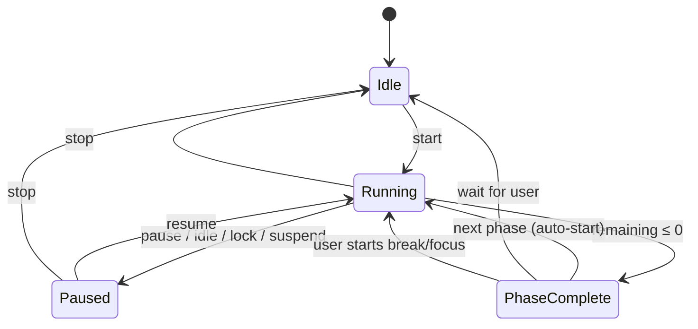

# Focus Engine

| Field | Value |
| --- | --- |
| Status | Approved for build |
| Version | 1.0 |
| Date | 2026-10-19 |
| Related | [Requirements](../01-product/requirements.md) · [Behavior engine](behavior-engine.md) · [Data & persistence](data-and-persistence.md) |

The focus engine is the utility half of Mochi: a drift-free Pomodoro-style timer that respects the user's absence, survives crashes and sleep, and produces honest local statistics. It is deliberately small in surface area and strict in semantics.

## 1. Principles

1. **Time is earned, not assumed.** Suspended, locked, and closed-app time never counts toward focus.
2. **No unearned completion.** A crash or power loss never awards a session that did not finish.
3. **Non-punitive.** Pausing, stopping, or missing a day is not a failure state. Streaks reset quietly; XP never decreases.
4. **One source of truth.** Main owns the timer; every surface mirrors it. There is no renderer-side countdown authority.
5. **Predictable under adversity.** Clock changes, DST, midnight, idle, lock, suspend, and kill -9 all have defined outcomes.

## 2. State model



A **session** is a sequence of phases: work → break → work → … → long break. A **phase** is one timed interval. Only one session exists at a time.

### 2.1 Phases

| Phase | Default | Config bounds | XP | Streak |
| --- | --- | --- | --- | --- |
| `work` | 25 min | 5–120 min | 1/min + 5 completion bonus | Counts |
| `shortBreak` | 5 min | 1–30 min | 2 on completion | No |
| `longBreak` | 15 min | 5–60 min | 2 on completion | No |

- Rounds default to 4; a long break follows the last work phase of a round set.
- Config is snapshotted at **session start**. Changing settings during a session applies to the next phase/session, not the current one. The Den shows "changes apply next session."
- Auto-start break (default **on**) and auto-start next work phase (default **off**).
- Long break can be skipped without penalty; the next work phase starts round 1.

### 2.2 Active session record

```ts
interface ActiveSession {
  id: string;                        // uuid v4
  startedAtWallMs: number;
  config: FocusConfig;               // immutable snapshot
  phase: 'work' | 'shortBreak' | 'longBreak';
  round: number;                     // 1..config.rounds
  phaseStartedAtWallMs: number;
  phaseDurationMs: number;
  remainingMsAtTick: number;         // persisted at least every 1 s
  lastTickWallMs: number;
  status: 'running' | 'paused';
  pausedAtWallMs: number | null;
  totalPausedMs: number;
  pauseReason: 'user' | 'idle' | 'locked' | 'suspend' | 'recovered' | null;
  segments: PhaseSegment[];          // completed work segments for date attribution
  phaseCompletionAwarded: boolean;
}
```

- `segments` contain `{ startedAtWallMs, endedAtWallMs, phase }` for work phases only, split at local midnight. They are appended on phase completion/stop; an in-progress phase is reconstructed on recovery.
- History is aggregated into daily stats; the raw session record is retained for 30 days for the "Recent" list and then discarded.

## 3. Timekeeping

### 3.1 Clocks

| Clock | Source | Used for |
| --- | --- | --- |
| Monotonic | `process.hrtime.bigint()` (main) | Elapsed time while the app is running |
| Wall | `Date.now()` | Persistence, local date keys, display deadlines, crash recovery |
| Local date | `Intl.DateTimeFormat` / `Temporal`-style helper | Midnight splits, streaks, daily aggregates |

The engine uses **monotonic time for the running countdown** so Windows clock adjustments cannot lengthen or shorten a block. It persists wall-clock timestamps and the last known remaining time so recovery never depends on a mono clock that did not exist before launch.

### 3.2 Tick and display

- The service emits a `focus:snapshot` at **1 Hz** for display while running, and immediately on any command.
- The Den interpolates display seconds locally between ticks using `performance.now()` and corrects on each snapshot. It never counts down independently for more than 1 s.
- A small `runtime.json` checkpoint is written every **2 s** while running (see [Data & persistence §4.4](data-and-persistence.md#44-runtime-checkpoint)); full-state writes remain debounced. Maximum crash loss is ≤ 2 s per [NFR-REL-03](../01-product/requirements.md#reliability-and-recovery).
- Completion is detected on a deadline timer (`remaining + 50 ms`) **and** on every tick. A missed timer still completes on the next tick; it is never skipped.

### 3.3 Pause/resume math

```
elapsedWhileRunning = monotonicNow - runningStartedAtMono - pausedAccumulatedMono
remaining = phaseDuration - elapsedWhileRunning
```

- Pause records `pausedAt`; resume adds the paused duration to `totalPausedMs`.
- Pause is idempotent: pausing a paused session returns the same state and reason (no double-count).
- Resume from `idle`, `locked`, or `suspend` is user-initiated unless the user enabled auto-resume.

## 4. Idle detection

- Poll `powerMonitor.getSystemIdleState(180)` every **5 s** while a work phase is running.
- If the state is `idle` for `IDLE_AUTO_PAUSE` (180 s), pause with reason `idle` and surface one non-blocking action: **Resume** / **Not now**.
- Up to 180 s of idle time may be counted before detection. This is intentional: a user reading or thinking without input should not be penalized by retroactive subtraction. The Den's session detail labels the idle pause so stats remain honest.
- On activity, the engine does **not** auto-resume unless `autoResumeAfterIdle` is on (default off). A single bubble or tray state offers resume.
- Idle detection is disabled during breaks; breaks are supposed to involve walking away.
- `getSystemIdleState` is used instead of custom hooks; no input content or keystroke data is observed.

## 5. Lock, suspend, and shutdown

| Event | Behavior |
| --- | --- |
| `lock-screen` | Pause at lock time with reason `locked` if `pauseWhenLocked` (default true). The timer does not accrue while locked. |
| `unlock-screen` | Status remains paused; a single "Resume focus?" bubble/tray action appears. No auto-focus, no modal. |
| `suspend` | Flush active session synchronously (best effort), pause with reason `suspend`, record `suspendedAtWallMs`. |
| `resume` | Remaining time equals the value at suspend (no accrual). Status stays paused; reason becomes `recovered` after the user resumes? No — it stays `suspend` until resume, then clears. |
| `query-session-end` | Final flush; the session is persisted as paused. No completion is awarded at shutdown. |
| Fatal main crash | Last persisted remaining time is used on next launch; the session is paused with reason `recovered`. |
| Kill -9 / power loss | Same as crash; at most 2 s of elapsed time is lost, never gained. |

If the app is reopened after the phase deadline passed while it was not running, the engine **does not** award completion. It offers:

- **Resume** with the remaining time saved at the last tick (which may be seconds), or
- **Finish and log as partial** if ≥ 50% was completed, or
- **Discard**.

This is deliberately conservative: focus time is only counted while Mochi is actually running and the phase actually completed.

## 6. Phase completion

On `remaining ≤ 0` for a running phase:

1. Mark the phase complete exactly once (`phaseCompletionAwarded` guard).
2. Append a work segment split at local midnight (§7).
3. Award XP:
   - Work: `floor(completedMinutes) × 1 + 5` (completion bonus), where completed minutes use the full configured duration, not the display rounding.
   - Break: `+2`.
4. Update the daily aggregate: focus minutes, completed sessions, breaks.
5. Update the streak on the first completed **work** phase of the local day.
6. Emit `focus:phaseCompleted` → behavior director celebrates; one toast (unless quiet/muted); tray updates.
7. Transition:
   - Work complete → next phase is a break (long if round % rounds === 0), auto-start if configured; otherwise idle in a "break ready" state.
   - Break complete → next work phase, auto-start if configured; otherwise idle.
   - Session complete → `Idle`, summary bubble/Den state, no extra celebration.

### 6.1 Stop and skip semantics

| Action | Work phase | Break phase |
| --- | --- | --- |
| **Pause** | Remaining time preserved; no XP; resumable | Same |
| **Stop** | If ≥ 50% completed, award prorated XP (`floor(minutes)`) but no completion bonus, no session count, streak unchanged. Otherwise no XP. | Break ends; no XP. |
| **Skip** | No XP, no session count, no streak; advances to the break | Advances to the next work phase with no XP |
| **Duplicate start** | Returns `already_active`; no state change | Returns `break_active`; no state change |

Partial credit is intentionally modest. It prevents a "start and immediately stop" XP farm while not punishing an honest half-block.

## 7. Dates, midnight, DST, and time zones

- Daily keys are local calendar dates (`YYYY-MM-DD`) derived from the user's current time zone.
- A work segment is split at each local midnight into per-day segments. A 23:50–00:15 block contributes 10 minutes to day 1 and 15 to day 2.
- DST spring-forward: a 60-minute block in a 23-hour day still counts as 60 minutes; the wall-clock timestamps may show a gap, but monotonic duration is authoritative.
- DST fall-back: no double counting; segments are non-overlapping in monotonic time and clamped to local-day boundaries.
- Time-zone changes: existing daily aggregates are not rewritten. New segments use the new local zone. The Insights view notes the current zone.
- Streaks are computed lazily from daily aggregates at read time and on phase completion. A day with zero completed work phases resets the current streak to 0; the longest streak is preserved.

## 8. Notifications and quiet behavior

| Moment | Toast | Pet | Sound |
| --- | --- | --- | --- |
| Focus start | No (user initiated) | `focus` posture | Soft cue if enabled |
| Work complete | Yes, once per phase | `celebrate` 2.5 s | Chime (unless muted) |
| Break start | Only if auto-started | Stretch/walk | Optional soft cue |
| Break complete | Yes, once | Look up / wave | Optional |
| Idle pause | No toast; one bubble/tray action | Sleepy | None |
| Lock/suspend pause | No immediate toast | Sleep | None |
| Resume after pause | No | Wake | None |

- Notifications use Windows toasts via Electron `Notification` with `app.setAppUserModelId` set. Clicking a toast opens the Den's Focus view.
- The OS Do Not Disturb setting is respected automatically by Windows. Mochi also has its own `quietHours` and `mute` settings; the stricter of the two wins.
- Deduplicate by `phaseId + event`; a retry or resume cannot produce a second toast.
- If notifications are disabled at the OS level, the visual celebration and bubble still occur.

## 9. Rewards and progression integration

- XP and streak rules are defined in [Behavior engine §6.3](behavior-engine.md#63-xp-and-levels) and implemented in `FocusRules` so they are unit-testable without the timer.
- The focus engine emits domain events (`PhaseCompleted`, `SessionStopped`, `BreakTaken`); the pet model applies mood/XP in response. The focus engine never mutates pet state directly.
- Starting a work phase suppresses roaming and unsolicited bubbles (behavior mode `focus`). Breaks restore roaming.
- Completing a phase triggers celebration regardless of whether the Den is open. If the pet is hidden, the celebration is deferred until it is shown, or dropped after 10 minutes to avoid a stale animation.
- Level-ups from focus XP trigger `levelUp` and a wave after the celebration, not during it.

## 10. Integration contracts

### Commands

| Command | Payload | Result |
| --- | --- | --- |
| `focus:start` | `{presetId?: string}` | `{ok, session}` or `{ok:false, code:'already_active' \| 'break_active' \| 'invalid_preset'}` |
| `focus:pause` | `{}` | `{ok, session}` (idempotent) |
| `focus:resume` | `{}` | `{ok, session}`; rejected if no paused session |
| `focus:skip` | `{}` | `{ok, session}`; skips current phase |
| `focus:stop` | `{}` | `{ok, summary}` with partial-credit info |
| `focus:setConfig` | `Partial<FocusConfig>` | `{ok, config}`; applies next session if active |

All commands are validated (Zod), rate-limited (except start/pause, which are inherently user-paced), and sender-checked. Results are typed; the renderer shows inline errors, never a modal.

### Events

| Event | Payload | Frequency |
| --- | --- | --- |
| `focus:snapshot` | Full `FocusView` incl. remaining | 1 Hz + on command |
| `focus:phaseCompleted` | `{phase, round, xpAwarded, next}` | Once per phase |
| `focus:sessionSummary` | `{minutes, xp, breaks, partial}` | On stop/complete |
| `focus:paused` | `{reason, remaining}` | On pause |
| `focus:configChanged` | `{config, appliesToNext}` | On valid change |

## 11. Edge cases

| Edge case | Resolution |
| --- | --- |
| Start focus while a break is active | Reject with `break_active`; UI offers "End break and start focus" (explicit command) |
| Change duration mid-phase | Allowed in settings; current phase keeps its snapshot; Den shows "applies next session" |
| System clock jumps forward 1 h | Monotonic countdown unaffected; wall-based history may show a gap; no completion is fabricated |
| System clock jumps backward | Monotonic unaffected; daily keys may repeat an hour; aggregates use segment overlap, no duplicate XP because phaseCompletionAwarded is per phase |
| Time zone changes mid-phase | Segment splitting uses the local zone at completion; a phase spanning the change is split at the new zone's midnights; no negative durations |
| App opened twice | Single-instance lock; no duplicate timer |
| Renderer closed while timer runs | Timer continues in main; Den re-syncs on open |
| Pet hidden during phase complete | Celebration deferred/dropped; toast still fires unless quiet |
| Notification permission denied | Visual-only completion; no error |
| Battery dies mid-phase | Same as power loss: paused/recovered at last tick, no completion |
| User pauses at 0.2 s remaining | Pause wins if processed before completion tick; completion is idempotent and cannot double-award |
| Auto-start next phase while user is away | Auto-start applies only if the next phase is a break by default; auto-start work is off and explicitly opt-in |

## 12. Testing

Required suites:

1. **Fake clock correctness.** 10,000 randomized pause/resume sequences preserve `remaining ∈ [0, duration]` and never double-award.
2. **Phase sequencing.** Rounds, long breaks, auto-start combinations, skip/stop from every state.
3. **Idle.** Simulated `getSystemIdleState` transitions trigger exactly one pause and one prompt.
4. **Suspend/lock.** 30-minute suspend adds zero focus time; resume is paused; no completion.
5. **Crash recovery.** Snapshot at 24:59 of a 25:00 block; relaunch paused with 1 s remaining; no completion until the user resumes and finishes.
6. **Midnight/DST.** Table-driven fixtures for 23:50–00:15, spring-forward, fall-back, time-zone change.
7. **Notifications.** Dedupe by phase/event; quiet hours suppress but celebration remains.
8. **XP/streak.** Partial thresholds, first session of day, missed day reset, longest streak preserved.
9. **Property tests.** XP monotonic, daily minutes non-negative, streak ≤ days since install.
10. **Soak.** 8-hour simulated day with random interactions; no drift > 1 s/hour, no unbounded history.

Tests use an injected `Clock`, `IdleStatePort`, and `NotificationPort`; they do not require Electron.

## 13. Privacy

The focus engine stores only durations, timestamps, phase types, pauses with reason codes, and completion status. It does not store window titles, app names, keystrokes, or content. Idle state comes from the OS idle timer (a duration), not input inspection. All data stays local unless the user explicitly exports it.

---

**Next:** [Data & persistence →](data-and-persistence.md)
