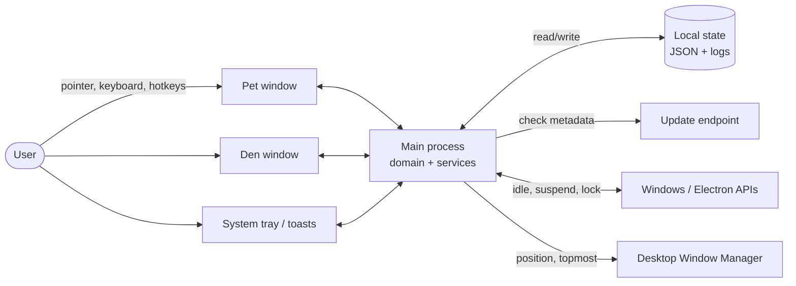
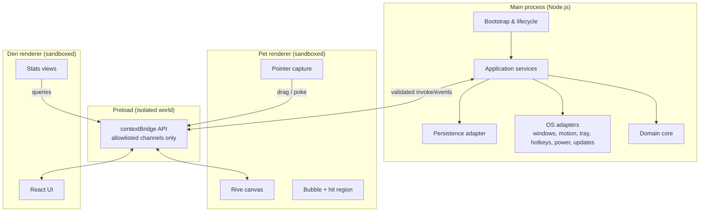
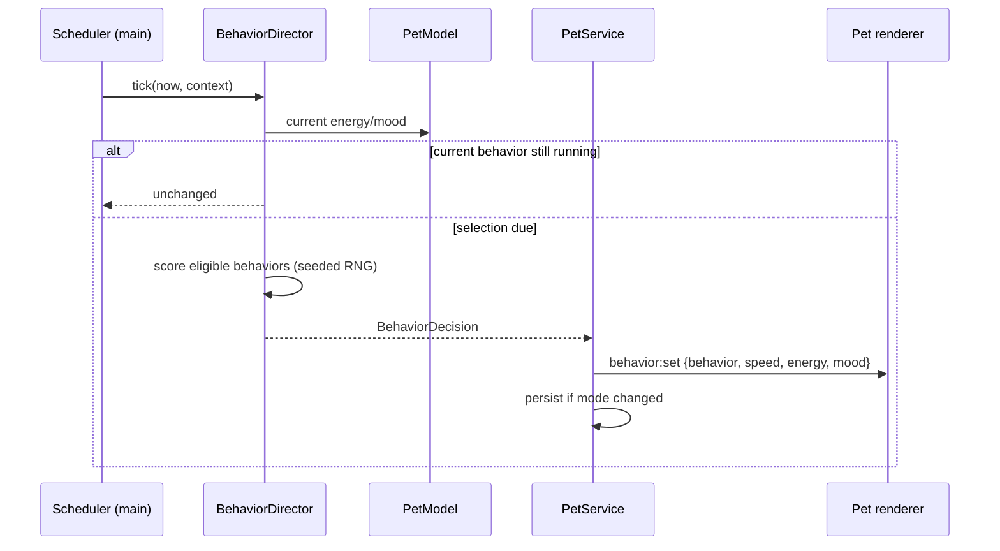
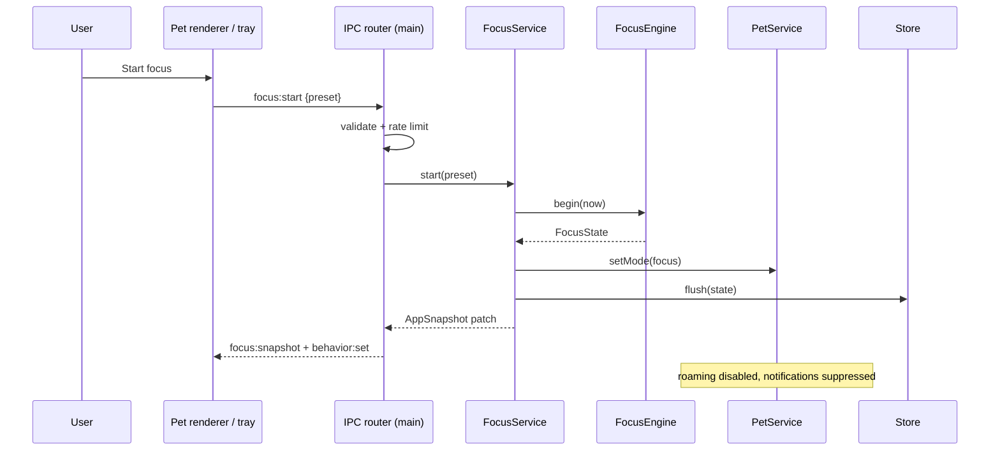
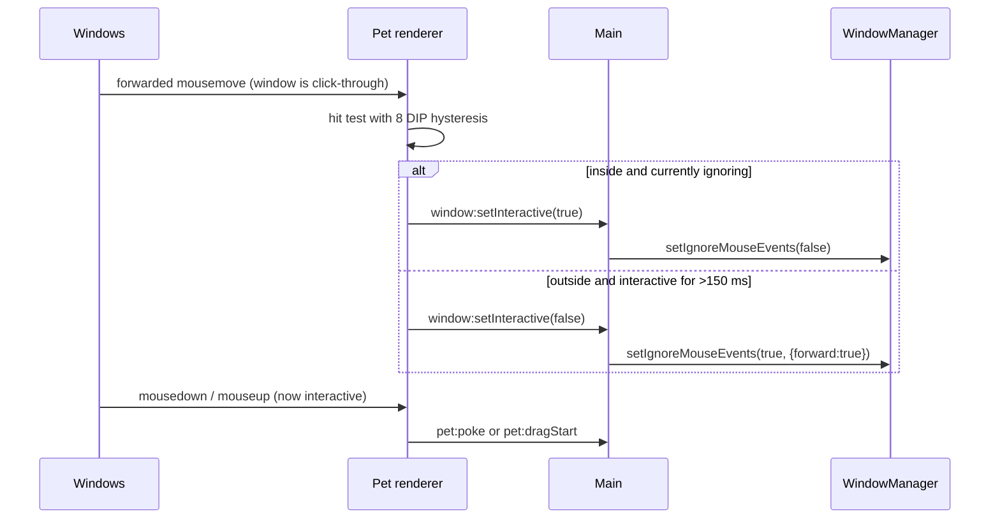

# Architecture Overview

| Field | Value |
| --- | --- |
| Status | Approved for build |
| Version | 1.0 |
| Date | 2026-10-19 |
| Related | [Requirements](../01-product/requirements.md) · [Desktop shell](desktop-shell.md) · [Behavior](behavior-engine.md) · [Animation](animation-system.md) · [IPC](ipc-contracts.md) |

## 1. Architectural goals

Mochi is a small product with an unusually sharp quality bar: it is always visible, always animating, always on top, and must never feel like a web page in a rectangle. The architecture is optimized for five qualities, in order:

1. **Feel.** Frame pacing, input latency, transparency, and drag behavior are first-class constraints, not polish.
2. **Invisibility.** The app must consume almost nothing while idle and must never steal focus or block clicks.
3. **Recoverability.** A crash, a killed process, or a monitor unplug must never lose progress or strand the pet off-screen.
4. **Testable behavior.** The pet's "brain" is deterministic, pure TypeScript with an injected clock and RNG. We can prove it does not get stuck.
5. **Trust.** Local-first data, sandboxed renderers, a narrow IPC surface, and no network dependency for core features.

Non-goals for the architecture: cross-platform abstraction layers, a plugin system, cloud sync, or a general-purpose animation editor. The design leaves seams for these without paying for them now.

## 2. Quality attribute scenarios

| Attribute | Scenario | Architectural mechanism |
| --- | --- | --- |
| Performance | Pet visible, user typing in another app, 8-hour day | Rive canvas paused when asleep/hidden; behavior tick at 2 Hz; no polling faster than 4 Hz except motion; bounded state and logs. |
| Latency | Cursor moves onto pet and clicks | Forwarded mouse events → hit test in renderer → IPC toggle → click handled; target ≤ 100 ms, with an 8 DIP hysteresis. |
| Smoothness | Mochi walks across the bottom edge | Main-process motion driver at 60 Hz, DIP-aware `setBounds`, Rive walk cycle synced to velocity; 30 Hz fallback with wider steps. |
| Reliability | Renderer crashes while focus is active | Main retains authoritative timer; `render-process-gone` recreates the window and pushes a fresh snapshot. |
| Recovery | Laptop sleeps for 30 minutes mid-focus | `powerMonitor` `suspend`/`resume` pauses the phase and adds suspended duration to pause time; no unearned completion. |
| Privacy | User works offline for a week | All core features local; update check is the only network call and fails quietly. |
| Security | Malformed IPC from a compromised renderer | Zod validation, sender check, channel allowlist, rate limits; rejected messages logged, never executed. |
| Maintainability | Designer renames a Rive state | CI loads the `.riv`, validates the contract, and fails before packaging. |

## 3. System context



There is no server. The update endpoint serves release metadata and signed artifacts only; it never receives user data.

## 4. Process and container model



| Process | Lifetime | Responsibility | Explicitly not responsible for |
| --- | --- | --- | --- |
| **Main** | App lifetime | Authoritative state, timers, persistence, window/motion control, tray, hotkeys, updates, logging | Rendering the pet or Den |
| **Preload (pet)** | Pet window lifetime | Narrow, typed `window.mochiPet` API; no business logic | State, validation authority, Node access |
| **Preload (den)** | Den window lifetime | Narrow, typed `window.mochiDen` API | State, validation authority |
| **Pet renderer** | Pet window lifetime | Drawing the Rive artboard, hit testing, pointer capture, bubble presentation, local input affordances | Deciding behavior, timers, persistence |
| **Den renderer** | Den window lifetime (hidden, not destroyed) | Timer/stats/settings UI, forms, accessibility | Owning session state |
| **Utility/GPU processes** | Chromium-managed | Compositing, rasterization | — |

Both renderers are sandboxed (`sandbox: true`, `contextIsolation: true`, `nodeIntegration: false`). The pet renderer has `backgroundThrottling: false` because its window is never focused; the Den uses the default throttling.

## 5. Layering and dependency rule

```
┌──────────────────────────────────────────────────────────┐
│ main/adapters        Electron, fs, Windows, tray, updater│
├──────────────────────────────────────────────────────────┤
│ application          use cases, ports, orchestration      │
├──────────────────────────────────────────────────────────┤
│ domain               pure TS: behavior, focus, pet, stats │
├──────────────────────────────────────────────────────────┤
│ shared               Zod contracts, IDs, constants        │
└──────────────────────────────────────────────────────────┘
```

**The domain imports only `shared`.** It has no `electron`, `fs`, `path`, `React`, or `setTimeout` imports. Time, randomness, and persistence are ports:

```ts
interface Clock { nowMs(): number; monotonicMs(): number; localDateKey(nowMs: number): string }
interface Rng { next(): number; pick<T>(items: readonly T[]): T }
interface PetStore { load(): Promise<LoadResult>; save(snapshot: PersistedState): Promise<void> }
```

This is enforced by an ESLint `no-restricted-imports` boundary rule (`NFR-MAINT-01`), so the rule is mechanical rather than cultural.

### Module map

| Path | Contents | May depend on |
| --- | --- | --- |
| `src/domain/behavior/` | `BehaviorCatalog`, `BehaviorDirector`, `RoamPlanner`, `BehaviorState` | `shared`, domain pet |
| `src/domain/focus/` | `FocusEngine`, `FocusRules`, phase state machine | `shared`, domain stats |
| `src/domain/pet/` | `PetModel`, energy/mood policies, XP/levels | `shared` |
| `src/domain/stats/` | Daily aggregation, streaks, date splitting | `shared` |
| `src/application/` | `PetService`, `FocusService`, `SettingsService`, `StatsService`, `BootstrapService`, port interfaces | domain, shared |
| `src/main/` | Entry point, window manager, IPC router, adapters | application, shared, Electron |
| `src/preload/` | Two narrow bridges | shared only (type imports) |
| `src/renderer/pet/` | Rive bridge, canvas, bubble, input capture | shared, React, Rive |
| `src/renderer/den/` | React app, design primitives, charts | shared, React |
| `scripts/` | Rive contract validator, icon pipeline, perf harness | build-time only |

## 6. State ownership

**Main owns all durable and time-based state.** The renderer is a projection plus ephemeral input.

| State | Owner | Persisted | Transport |
| --- | --- | --- | --- |
| Behavior mode, current behavior, queue | Main (`BehaviorDirector`) | Current mode only (wake/sleep), not the queue | `state:patch` / `behavior:set` |
| Energy, mood, XP, level | Main (`PetModel`) | Yes | `state:patch` |
| Focus phase, remaining, config, history | Main (`FocusEngine`) | Yes | `focus:snapshot` @ 1 Hz + transitions |
| Settings | Main (`SettingsService`) | Yes | `settings:snapshot` / `settings:patch` |
| Daily aggregates, streaks | Main (`StatsService`) | Yes | `stats:range` query |
| Window bounds / monitor | Main (`WindowManager`) | Yes | Not sent to renderer |
| Hover, pointer position, drag offset | Pet renderer | No | Commands to main |
| Bubble visible/copy | Main decides, renderer presents | No (copy authored) | `bubble:show` event |
| Den form drafts | Den renderer | No, until saved | Settings command |
| Rive playback internals | Rive runtime | No | Driven by view model |

### Snapshot + patch protocol

- On renderer load, it calls `bootstrap` and receives a full `AppSnapshot` with `revision`.
- Main emits typed patches with monotonically increasing `revision`; renderer applies only `revision === last + 1`, otherwise requests a resync.
- Snapshots are immutable (`readonly` types) and validated with Zod in development; production trusts main but still validates command payloads.
- There is exactly one source of truth for focus time. The Den never runs its own countdown; it interpolates display seconds between 1 Hz ticks and corrects on each tick.

## 7. Key runtime flows

### 7.1 Behavior tick (every 500 ms)



The director runs at 2 Hz. Roam planning and window motion run on a separate 60 Hz driver only while walking. Focus ticking is independent (deadline-driven, 1 Hz UI emission).

### 7.2 Start focus



### 7.3 Pointer onto pet (click-through toggle)



### 7.4 Motion (walking)

`RoamPlanner` produces a trajectory in display DIP coordinates. `MotionDriver` advances it at 60 Hz on a drift-corrected timer and calls `setBounds` only when the rounded integer position changes. Rive receives `speed` normalized to the trajectory's velocity and `facing` to flip the character. If the frame budget is exceeded for 10 consecutive frames, the driver drops to 30 Hz and widens its step; the behavior is otherwise unchanged. Details and fallbacks are in [Desktop shell](desktop-shell.md#5-motion-driver-roaming).

## 8. System constants

These values are canonical. Requirements may impose thresholds around them, but implementations must source the numbers from `src/shared/constants.ts` rather than duplicating literals.

| Constant | Value | Used by |
| --- | --- | --- |
| `PET_WINDOW_WIDTH` × `HEIGHT` | 320 × 360 DIP | Window manager, hit test, Rive layout |
| `PET_ART_WIDTH` × `HEIGHT` | 200 × 220 DIP | Rive layout, bubble offset |
| `BUBBLE_MAX_WIDTH` × `HEIGHT` | 272 × 96 DIP | Bubble layout |
| `PET_HIT_ELLIPSE` | 168 × 200 DIP, centered on body | Hit testing |
| `HIT_HYSTERESIS` | 8 DIP | Click-through toggle |
| `INTERACTIVE_EXIT_DELAY` | 150 ms | Click-through toggle |
| `DRAG_THRESHOLD` | 4 DIP | Click vs. drag |
| `CLICK_MAX_DURATION` | 400 ms | Click vs. drag |
| `SNAP_DISTANCE` | 48 DIP | Drop-to-corner |
| `SNAP_DURATION` | 120–220 ms | Snap animation |
| `BEHAVIOR_TICK` | 500 ms | Behavior director |
| `MICRO_BEHAVIOR_INTERVAL` | 4–12 s | Idle variation |
| `ROAM_INTERVAL` | 90–240 s | Walk scheduling |
| `ROAM_SPEED` | 60–90 DIP/s | Motion driver |
| `SLEEP_AFTER_IDLE` | 600 s | Sleep policy |
| `QUIET_HOURS_DEFAULT` | 22:00–07:00 local | Sleep policy |
| `FOCUS_DEFAULT` / `SHORT_BREAK` / `LONG_BREAK` / `ROUNDS` | 25 / 5 / 15 min / 4 | Focus engine |
| `FOCUS_LIMITS` | 5–120 / 1–30 / 5–60 / 2–8 | Settings validation |
| `IDLE_AUTO_PAUSE` | 180 s | Focus engine |
| `FOCUS_UI_TICK` | 1000 ms | Focus service |
| `MOTION_TICK` | 16.67 ms (60 Hz), fallback 33.3 ms | Motion driver |
| `MOTION_FALLBACK_THRESHOLD` | 10 consecutive over-budget frames | Motion driver |
| `PERSIST_DEBOUNCE` | 500 ms, max delay 2 s | Persistence |
| `EVENT_LOG_RETENTION` | 30 days / 5 MB | Diagnostics |
| `UPDATE_CHECK_DELAY` | 10 s after `ready-to-show` | Updater |
| `UPDATE_CHECK_INTERVAL` | 6 h | Updater |
| `BUBBLE_MIN_GAP` | 5 min (unsolicited) | Bubble policy |
| `BUBBLE_MAX_PER_HOUR` | 6 | Bubble policy |
| `POKE_MOOD_CAP` | +8 per local day | Pet model |
| `MAX_OFFLINE_HOURS` | 12 h for energy recovery accrual | Pet model |
| `IPC_INVOKE_TIMEOUT` | 5 s | IPC client |
| `IPC_DRAG_RATE` | 120 messages/s, coalesced | IPC router |

## 9. Technology stack and versions

| Concern | Choice | Baseline | Why |
| --- | --- | --- | --- |
| Runtime | Electron | 44.9.x | Best Windows transparency/frameless behavior; mature native window control; team velocity |
| UI | React 19 + TypeScript strict | 19.x / 5.x | Ecosystem, predictable rendering, strong typing |
| Build | electron-vite | current at scaffold | Fast HMR, main/preload/renderer bundling, simple asset handling |
| Animation | `@rive-app/react-canvas` | 4.37.0 (runtime 2.45.0) | State machines, view-model data binding, vector quality, small runtime |
| Validation | Zod | 4.x | Shared schemas for IPC, settings, persistence, migrations |
| Den styling | Tailwind CSS 4 + CSS variables | current | Token-driven theming, rapid accessible UI |
| Primitives | Radix UI (selective) | current | Accessible dialogs, menus, tooltips |
| Den transitions | Motion (Framer Motion) | current | Declarative enter/exit, respects reduced motion |
| Den client state | Zustand | 5.x | Small, no boilerplate; server state comes from IPC |
| Icons | Lucide React | current | Consistent, tree-shakeable |
| Logging | electron-log | 5.x | File rotation, main/renderer transports, no native deps |
| Updates | electron-updater | 6.x | Signature verification, NSIS differential updates |
| Packaging | electron-builder | 26.x | Per-user NSIS, signing, portable target |
| Unit tests | Vitest | 3.x | Fast, TS-native, fake timers |
| E2E | Playwright `_electron` | current | Real Electron launch, main-process evaluation |
| Lint/format | ESLint 9 flat + Prettier 3 | current | Boundary rules, consistent style |

**Version policy:** pin exact versions in `package.json` for Electron, Rive, electron-builder, and electron-updater. Renovate/Dependabot may propose upgrades; Electron majors require a full manual QA pass and an ADR note.

## 10. Failure philosophy

| Failure | Response | User sees |
| --- | --- | --- |
| Rive WASM fails to load | Retry once, then static fallback silhouette | Pet silhouette + tooltip; Den works; error logged |
| Rive asset contract mismatch | Treat as asset failure in production; fail CI in build | Fallback, never a blank window |
| Renderer crash | Recreate window; push fresh snapshot | Brief disappearance, then pet returns |
| Main-process uncaught exception | Log, attempt final flush, show native error dialog, exit | Clear message with log path; no silent zombie |
| Corrupt state | Load backup; quarantine invalid file | One-time explanation, defaults, path to files |
| Update fails | Keep current version, retry on next interval | No interruption; "up to date" state |
| Hotkey conflict | Mark unbound, offer alternatives | Non-blocking notification + Settings entry |
| Display unplugged | Re-clamp to nearest work area | Pet appears on primary display |
| Notification permission denied | Visual bubble fallback | No error; documented in Settings |

Expected failures are modeled as typed results (`{ ok: false, code, message }`), not exceptions. Exceptions are reserved for programmer errors and are logged with context. We do not swallow errors to keep a green build (`NFR-REL-04`).

## 11. Evolution and seams

- **Multiple pets / user Rive files (v2):** `AnimationPort` already isolates the Rive runtime; a pet asset registry and signature validation would slot in without changing the domain.
- **Cloud sync (not planned):** persistence is behind `PetStore`; a sync adapter could implement the same port, but conflict resolution would need a new ADR.
- **macOS/Linux:** the domain is portable; window/click-through/motion adapters are Windows-specific behind interfaces. No promise is made in v1.
- **Native helper (future):** if click-through or fullscreen detection needs `WM_NCHITTEST`/`SHQueryUserNotificationState`, it can replace the renderer hit test behind `HitTestPort` without touching behavior.

## 12. Decision summary

| Decision | ADR |
| --- | --- |
| Electron + React + TypeScript | [ADR-0001](../04-adr/0001-electron-react-typescript.md) |
| Rive for all pet animation | [ADR-0002](../04-adr/0002-rive-animation-runtime.md) |
| Main process is the authority | [ADR-0003](../04-adr/0003-main-process-authority.md) |
| Rive data binding over state-machine inputs | [ADR-0004](../04-adr/0004-rive-data-binding.md) |
| Tight transparent window + native motion driver | [ADR-0005](../04-adr/0005-transparent-roaming-window.md) |
| Renderer-side hit testing with forwarded mouse events | [ADR-0006](../04-adr/0006-click-through-hit-testing.md) |
| Versioned JSON store, no native DB | [ADR-0007](../04-adr/0007-versioned-json-store.md) |
| electron-builder + electron-updater, signed | [ADR-0008](../04-adr/0008-packaging-signing-updates.md) |
| Privacy-first local observability | [ADR-0009](../04-adr/0009-privacy-first-observability.md) |

---

**Next:** [Desktop shell and Windows integration →](desktop-shell.md)
