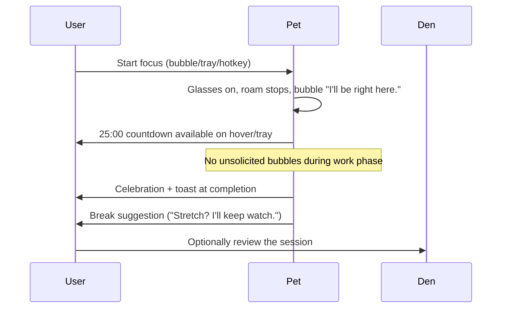

# Experience Specification

| Field | Value |
| --- | --- |
| Status | Approved for build |
| Version | 1.0 |
| Date | 2026-10-19 |
| Related | [PRD](../01-product/prd.md) · [Visual & motion](visual-and-motion.md) · [Requirements](../01-product/requirements.md) |

This document defines how Mochi feels to use: the flows, the interaction grammar, the surfaces, the words, and the accessibility contract. It is written to be implemented and tested, not just admired.

## 1. Experience principles

1. **Quiet presence.** The pet occupies less than 1% of the screen and asks for attention only when it has something useful to say.
2. **Consent over surprise.** Nothing expands, speaks, or notifies without a reason the user can predict.
3. **One clear next action.** Every bubble and empty state offers at most one primary action and an easy dismissal.
4. **Physicality.** Dragging has weight, dropping settles, petting reacts. The pet feels like an object, not a video.
5. **No shame.** Copy never references missed days, broken streaks, or "should." Rest is a valid state.
6. **Reversible.** Hide, pause, mute, reset, and quit are always discoverable; destructive actions confirm.
7. **Accessible by default.** Keyboard equivalents, reduced motion, high contrast, and screen-reader semantics are part of the design, not a patch.

## 2. Character

### 2.1 Who Mochi is

Mochi is a small marshmallow-shaped cat: soft, curious, a little sleepy, and completely unjudgmental. It has no job, no advice, and no opinions about your productivity. It is a companion, not a coach.

- **Temperament:** calm, playful in short bursts, easily fascinated by the cursor.
- **Physicality:** round body, small paws, expressive ears and tail, a slightly oversized scarf.
- **Voice:** speaks in short, warm observations. Never exclamation-heavy, never baby talk, never sarcastic.
- **Routine:** wakes with the computer, naps in the evening, celebrates completed blocks, stretches on breaks.

### 2.2 What Mochi is not

- Not a mascot for a brand. It does not advertise.
- Not a therapist. It does not ask about feelings or give mental-health advice.
- Not a pet that can be neglected to death. There is no dying, no hunger meter, no guilt.
- Not a notification machine. Silence is its default.

## 3. Core flows

### 3.1 First run

1. Installer completes; Mochi launches (unless "Launch at login" was chosen, it starts on demand).
2. The pet window appears in the bottom-right corner with a soft drop-in (220 ms, ease-out-back) and a wave.
3. Bubble: **"Hi, I'm Mochi."** Primary action: **Start a 25-minute focus**. Secondary: **Just say hi** (dismiss).
4. If the user starts, the timer begins, the pet puts on tiny glasses, and a second bubble confirms: **"I'll be right here."**
5. The tray icon appears with a tooltip. No modal tour, no account, no permissions dialog.
6. The Den is discoverable via double-click, tray, or `Ctrl+Alt+D`; the first visit highlights Home and the timer, not a carousel.

**Success:** a user can be in a focus block within 3 interactions and 30 seconds.

### 3.2 Daily use

- Mochi idles, blinks, occasionally walks along the bottom edge, and sleeps when the user is away.
- Hovering shows a subtle attentive look; after 1.2 s, a small hint bubble may appear once per session: **"Focus for 25 minutes?"**
- The tray tooltip shows the current state and, during focus, the remaining time.
- Right-clicking the pet opens a native menu with the next best actions.
- Starting a focus block is possible from the pet bubble, tray, hotkey, or Den. All paths converge on the same state.

### 3.3 Focus block



- Work phase: no roaming, no unsolicited bubbles, no update prompts. The pet's posture is focused; breathing slows slightly.
- Halfway mark: no notification. The pet may glance up once; this is decorative and silent.
- Completion: 2.5 s celebration, a single toast, XP credited, streak updated. Bubble: **"25 minutes. That's a good block."**
- Break: pet stretches, roams if the user allows it, suggests water or a stretch. One message, no follow-up.
- If the user drifts (system idle ≥ 3 min): pause, pet gets sleepy, one gentle action to resume. No guilt.

### 3.4 Sleep and quiet hours

- After 10 minutes without input, Mochi curls up. A subtle Zzz pulse is the only motion.
- During configured quiet hours (default 22:00–07:00), sleep begins after 5 minutes idle; if Mochi is already idle for 5+ minutes when quiet hours start, it settles on the next check.
- A click wakes it for a moment, then it settles again. Starting a focus session wakes it fully and suppresses sleep until the phase ends.
- No "good night" notification. The change is visible, not announced.

### 3.5 Return after absence

- The app opens in `awake`; energy has recovered offline (capped), mood has decayed slightly (max −4).
- No guilt copy, no "we missed you," no streak-loss modal.
- Home shows the last session and a simple prompt: **"A 10-minute block to start?"**
- If a focus phase was interrupted, a single banner offers **Resume** or **Discard**; nothing is awarded until the user acts.

### 3.6 Hide, pause, quit

| Intent | Path | Result |
| --- | --- | --- |
| Hide the pet | Tray → Hide, `Ctrl+Alt+P` | Window hides; timer continues; tray remains |
| Show the pet | Tray → Show, `Ctrl+Alt+P` | Pet returns with a wave; state preserved |
| Pause focus | Tray/context menu/hotkey | Timer pauses; pet relaxes; resume offered |
| Mute | Tray or Settings | Sound off; visual cues remain |
| Quit | Tray → Quit | Flushes state; exits within 2 s |
| Uninstall | Windows Settings | Offers keep/delete data; removes login item |

There is no "close" button on the pet. Alt+F4 is ignored; quit is explicit. This avoids accidental data loss and zombie processes.

## 4. Interaction grammar

| Input | Target | Behavior | Feedback |
| --- | --- | --- | --- |
| Hover | Pet body | Attentive look toward cursor; optional hint after 1.2 s | Subtle head/ear motion, no bubble by default |
| Single click | Pet body/head | Poke/pet reaction | Squish/purr pose, +1 mood (capped), ≤ 100 ms |
| Double click | Pet | Open Den | Den focuses within 300 ms |
| Drag | Pet | Pick up, dangle, drop, snap | Window follows 1:1; settle 250 ms; corner snap |
| Right click | Pet | Native context menu | Menu reflects focus state |
| Scroll | Pet | Nothing | No zoom, no resize |
| Keyboard | Global | Toggle pet / start-pause focus / open Den | Tray tooltip and pet state update |
| Click action | Bubble | Run the single primary action | Bubble dismisses; action executes |
| Click ✕ | Bubble | Dismiss | Bubble fades in 120 ms |

### 4.1 Context menu

```
Mochi — Focusing (12:34 left)
─────────────────────────────
Pause focus
Skip to break
─────────────────────────────
Take a break
Bring Mochi here
─────────────────────────────
Open Den
Settings…
─────────────────────────────
Hide Mochi
Quit Mochi
```

- Items are disabled when not applicable, never hidden, so the menu is stable.
- "Take a break" when idle opens a 5-minute break without a work phase.
- The menu is native (Windows look/feel, keyboard accessible, screen-reader friendly).
- Destructive "Quit" is last; no confirmation required because state is flushed and recoverable.

### 4.2 Bubble rules

- Maximum 80 characters, one action.
- Appears above the pet, never covers the face.
- Auto-dismiss 4–8 s; pauses on hover.
- Clicking the bubble's body dismisses; clicking the action executes and dismisses.
- Never used for errors that require a decision; those live in the Den or a native dialog.
- Screen readers announce it once via `role="status"`; decorative animations are `aria-hidden`.

## 5. Surfaces

### 5.1 Pet window

The pet is the product's face. Its silhouette, shadow, and scarf must read at 100% scale on a 1080p display and remain legible at 200%. It never displays text except the bubble. It has no context menu chrome, no close button, and no hover outline (except high contrast).

### 5.2 Bubble

A warm, near-opaque card with a small tail pointing at the pet. Max width 272 DIP, 12 px radius, 1 px inner border, soft shadow inset. Primary action is a text button; dismiss is a subtle ✕. It uses the Den's typography and theme. It is not a tooltip and not a notification center.

### 5.3 Tray

Native Windows notification-area icon. Tooltip is the status line. Left click toggles the pet; right click opens the menu. The icon has a small state badge (focus dot, sleep moon) rendered at 16/20/24/32 px. Badges must remain legible at 16 px.

### 5.4 Den

A calm, warm window with a persistent left sidebar and a content area. It is where numbers, settings, and recovery live.

```
┌───────────────────────────────────────────────────────────────┐
│  Mochi                                      ─   □   ✕         │ 40 px title overlay
├──────────────┬────────────────────────────────────────────────┤
│  Home        │                                                │
│  Focus       │   Content (max 840 px, 32 px gutters)          │
│  Insights    │                                                │
│  Locker      │                                                │
│  Settings    │                                                │
│              │                                                │
│  ─────────   │                                                │
│  Mochi · Lv 4│                                                │
└──────────────┴────────────────────────────────────────────────┘
```

| View | Content | Primary action |
| --- | --- | --- |
| **Home** | Greeting, pet status (energy/mood), today's focus minutes, current streak, quick-start presets, last session | Start focus |
| **Focus** | Large timer ring, phase/round, start/pause/skip/stop, preset editor, auto-start toggles | Start / Pause |
| **Insights** | 7/30-day bar chart, totals, best day, streak cards, recent sessions | Change range |
| **Locker** | Cosmetic grid, equipped state, level requirements, preview | Equip |
| **Settings** | General, Pet, Focus, Shortcuts, Updates, Privacy & Data, About | Save (auto-save with "Saved" confirmation) |

Behavior:

- Opening the Den does not pause the pet or the timer; it is a window, not a mode.
- Timer state in the Den mirrors main at 1 Hz; controls are optimistic only for the pressed state, never for time.
- Settings save automatically with a 400 ms debounce and an inline "Saved" confirmation. Invalid values show inline errors and are not persisted.
- Closing the Den hides it; the pet remains. Reopening restores the last view and scroll.
- The Den never opens automatically except on a fatal error that requires user action (with a clear explanation).

### 5.5 Notifications

- Windows toast, attributed to Mochi with the app icon.
- Only phase completion and auto-started breaks produce toasts; no marketing, no reminders, no re-engagement.
- Clicking a toast opens the Den Focus view.
- Quiet hours and mute suppress sound; the OS Do Not Disturb is respected automatically.
- If notifications are disabled, the visual celebration and bubble still happen.

## 6. Copy and voice

### 6.1 Voice rules

| Do | Don't |
| --- | --- |
| Short, concrete, warm | "Hey superstar! You crushed it!!!" |
| "25 minutes. That's a good block." | "Amazing job! You're on fire! 🔥" |
| "Want to try 10 minutes?" | "You haven't focused in 3 days." |
| "I'll be right here." | "Don't let me down." |
| "Time for a stretch?" | "Break time! You must rest now." |
| "A quiet week. Want to start small?" | "Your streak is broken." |

### 6.2 Copy inventory

| Context | Strings (examples) | Notes |
| --- | --- | --- |
| Greeting | "Hi, I'm Mochi." · "Back again." · "Morning." | Time-aware, no name unless set |
| Focus start | "I'll be right here." · "25 minutes. Let's go." | No cheerleading |
| Focus complete | "25 minutes. That's a good block." · "Done. Stretch?" | Specific duration |
| Break | "Stretch? I'll keep watch." · "Water?" | One suggestion |
| Idle hint | "Focus for 25 minutes?" | Max once per session |
| Sleep | No text | Visual only |
| Return | "A 10-minute block to start?" | No guilt |
| Level up | "Level 4. New scarf unlocked." | Concrete reward |
| Error (recoverable) | "I couldn't load my animation. The timer still works." | Honest, actionable |
| Empty stats | "No focus blocks yet. A 10-minute one counts." | Encouraging, not pushy |

Copy is stored in `shared/copy/`, externalized for localization, and reviewed by design. No generated text, no emoji in core messages (a single optional sparkle glyph in celebration is allowed).

## 7. Accessibility

### 7.1 Requirements

- **Keyboard:** every Den action reachable without a pointer; visible focus ring (2 px, 3:1 contrast); logical tab order; Escape closes overlays/hides Den.
- **Screen readers:** Den has landmarks, headings, labeled controls, and live regions for timer completion. Bubbles use `role="status"` and announce once. The pet canvas is `aria-hidden`.
- **Reduced motion:** no window roaming, no confetti, no large pose changes; transitions ≤ 150 ms; blink rate reduced; Zzz pulse static. Follows OS setting unless overridden.
- **High contrast:** Den and bubble use 7:1 text contrast; pet art gains a 2 px outline variant; state is always labeled in tray/Den, never color-only.
- **Target size:** interactive controls ≥ 32×32 DIP in the Den; pet hit region is large by design.
- **Sound:** all sound cues have visual equivalents; sounds are optional from first run.
- **Notifications:** never the sole channel for critical state; the timer and tray mirror everything.

### 7.2 Keyboard map

| Key | Context | Action |
| --- | --- | --- |
| `Tab` / `Shift+Tab` | Den | Move focus |
| `Enter` / `Space` | Den | Activate |
| `Escape` | Den | Close overlay / hide Den |
| `Ctrl+Alt+P` | Global | Show/hide pet |
| `Ctrl+Alt+F` | Global | Start/pause focus |
| `Ctrl+Alt+D` | Global | Open Den |
| `Ctrl+Shift+P` | Dev only | Performance overlay |
| `Ctrl+Shift+B` | Dev only | Behavior overlay |

Hotkeys are configurable only after v1; the defaults are shown in Settings and the Den's empty state.

## 8. States and edge cases

| State | Design response |
| --- | --- |
| Loading (pet) | Window hidden; if > 3 s, show silhouette + "Starting…" tooltip |
| Animation unavailable | Static silhouette; bubble/tooltip explains; Den shows diagnostics link |
| No focus history | Empty Insights with a 10-minute starter, not a blank chart |
| Corrupt state recovered | One-time Den banner with "Open data folder"; no data-loss silence |
| Notifications disabled | In-app celebration; Settings shows the OS state |
| Hotkey conflict | Inline warning in Settings; action remains available in tray |
| Update available | Quiet tray badge; Den About shows "Update ready"; install only when focus is idle |
| Update failed | About shows last error + "Retry"; no modal |
| Display unplugged | Pet moves to primary corner; no error message unless it fails |
| Offline | Everything works; update status shows "Offline, will retry" |
| Timer active when quitting | Quit flushes; next launch offers resume (paused) |
| User is in a fullscreen game | Optional hide-in-fullscreen; no toast during fullscreen |
| Windows high contrast | Art outline + Den theme; no color-only status |
| Reduced motion | Stationary pet; no confetti; sleep still visible |
| Multi-monitor | "Bring Mochi here" in tray; remembers per-display placement |

## 9. Onboarding details

- No carousel. The pet's first bubble is the onboarding.
- After the first focus block, a single Den card offers: launch at login, sound, and quiet hours. All optional, skippable.
- The Den Home shows a "Getting started" card only until the first completed session, then disappears permanently.
- Permissions: no onboarding permission prompts. The first notification triggers the OS prompt naturally; if denied, the app adapts silently.

## 10. UX acceptance criteria

- [ ] A new user can start a focus block in ≤ 3 interactions and ≤ 30 s.
- [ ] The pet never obscures the taskbar, a system dialog, or the active window's primary controls in its default corner.
- [ ] Hovering, clicking, dragging, double-clicking, and right-clicking all behave as specified with ≤ 100 ms feedback.
- [ ] Every bubble has one clear action and a dismiss path; no bubble exceeds 80 characters.
- [ ] No copy references missed days or broken streaks.
- [ ] Every Den view is usable keyboard-only and at 200% scaling.
- [ ] Reduced-motion mode removes all large motion and confetti while preserving state clarity.
- [ ] Hiding and restoring the pet preserves timer state and placement.
- [ ] The user can always reach Hide, Pause, Mute, and Quit within two actions.
- [ ] Error states explain what happened and what still works; no dead ends.

---

**Next:** [Visual & motion system →](visual-and-motion.md)
