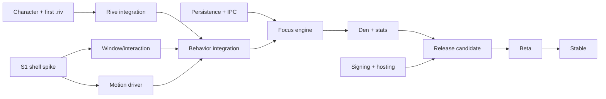

# Roadmap and Delivery Plan

| Field | Value |
| --- | --- |
| Status | Approved |
| Version | 1.0 |
| Date | 2026-10-19 |
| Target | v1.0 public release, 8 working weeks from kickoff |
| Related | [PRD](../01-product/prd.md) · [Requirements](../01-product/requirements.md) · [Risk register](risk-register.md) · [Test strategy](test-strategy.md) |

This plan assumes a small team and a fixed quality bar. It is sequenced so the riskiest platform work happens first, the pet becomes real before the product grows around it, and release work is not compressed into the last three days.

## 1. Assumptions

- **Team:** 2 full-time engineers, 1 designer (~60% allocation), product/QA shared at ~30%. A solo engineer should plan for 14–16 weeks, not 8.
- **Availability:** the designer can deliver a first `.riv` file by the end of week 1 and iterate weekly.
- **Code signing and update hosting** decisions land by week 5 (O-2/O-3), or release slips.
- **Test hardware:** one Windows 11 reference laptop, one Windows 10 VM, one 4K display, one low-end VM.
- **Scope:** v1.0 as defined in the [PRD](../01-product/prd.md#8-scope). Anything not in the requirements is backlog.
- **Estimates** are engineer-days including tests and review, not calendar days. The total is ~92 engineer-days; 2 engineers × 40 days = 80, so the plan relies on parallelism, a 15% buffer, and cutting P1 polish before P0 quality.

## 2. Phase overview

| Phase | Weeks | Theme | Exit milestone |
| --- | --- | --- | --- |
| **0 — Foundations** | 1 | Prove the shell and pipeline | M1: S1/S2 pass |
| **1 — The pet** | 2–3 | A living character on the desktop | M2: Pet alive |
| **2 — Focus & Den** | 4–5 | The utility layer | M3: End-to-end focus loop |
| **3 — Craft** | 6 | Feel, accessibility, resilience | M4: Release candidate |
| **4 — Release** | 7–8 | Beta, fixes, stable | M5: Beta; M6: Stable |

```mermaid
gantt
    title Mochi v1.0
    dateFormat  X
    axisFormat  W%V
    section Foundations
    S1 shell feel / S2 Rive pipeline :0, 5d
    Scaffold + CI                     :0, 3d
    section Pet
    Windows, click-through, drag      :5d, 8d
    Behavior engine + motion          :5d, 8d
    Rive integration                  :5d, 8d
    Persistence + IPC                 :5d, 8d
    section Focus
    Focus engine + notifications      :10d, 8d
    Den shell + Home/Focus/Insights   :10d, 10d
    Settings + stats                  :10d, 8d
    section Craft
    Locker + accessibility + sound    :15d, 5d
    Perf + fault injection            :15d, 5d
    section Release
    Packaging, signing, updates       :20d, 5d
    Beta + fixes                      :25d, 8d
```

## 3. Phase 0 — Foundations (week 1)

**Goal:** retire the platform risks before building product around them.

### Deliverables

- Repository scaffold: `electron-vite`, TypeScript strict, ESLint boundary rules, Prettier, Vitest, Playwright, CI (lint/typecheck/test/build).
- Domain/application/main/preload/renderer folder skeleton with the dependency rule enforced.
- A blank transparent pet window, a Den shell, tray, single-instance lock, logging.
- Shared contracts: `constants.ts`, `rive-contract.ts`, IPC envelope and first Zod schemas.
- Static silhouette fallback and the debug hooks required for S1.
- Design: character direction signed off; first `mochi.riv` with the 8 states and view model stubs.

### Spikes

| Spike | Timebox | Question | Exit criteria | Decision affected |
| --- | --- | --- | --- | --- |
| **S1 — Shell feel** | 3 days | Can a transparent, always-on-top, click-through window drag and roam smoothly on Windows 11/10, at 100/150/200% DPI? | Recorded video + metrics: no rectangle/halo, first-click success ≥ 99%, ≥ 95% frames ≤ 16.7 ms in roam, no stall > 50 ms, ignore=true after crash/hide. | ADR-0005, ADR-0006 |
| **S2 — Rive pipeline** | 2 days | Can we load the bundled `.riv` + local WASM offline, bind the view model, drive all 8 states, and validate the contract in CI? | A sample file drives Idle/Walk/Sleep/Wake/Wave/Focus/Celebrate/Drag; validator passes; `enableRiveAssetCDN:false` proven by a network trace. | ADR-0002, ADR-0004 |
| **S3 — Perf baseline** | 1 day (extends into Phase 1) | What is Electron's floor on the reference/low-end machines with a moving transparent window? | Idle/roam/sleep CPU and memory numbers recorded; budget risks listed. | Performance budgets |

**Gate M1:** S1 and S2 pass. If S1 fails on motion smoothness, enable stage mode and re-measure before proceeding. If S1 fails on click-through reliability, scope the native hit-test helper as a contingency (not an automatic v1 commitment). If S2 fails, the animation plan is blocked and the release date is re-planned.

## 4. Phase 1 — The pet (weeks 2–3)

**Goal:** Mochi lives on the desktop, moves, reacts, sleeps, and survives restarts. No focus timer yet.

### Workstreams

| Workstream | Work | Estimate |
| --- | --- | --- |
| Window shell | Pet window options, placement/clamping, DPI/multi-monitor, tray, hotkeys, hide/show, power events | 8 d |
| Interaction | Hit test + toggle, manual drag, click-vs-drag, snap, context menu, bubble presentation | 6 d |
| Behavior | PetModel, BehaviorCatalog, director, seeded RNG, energy/mood/offline accrual, watchdog | 6 d |
| Motion | Roam planner, 60/30 Hz driver, speed/facing sync, cancellation | 4 d |
| Animation | Rive stage, view-model bridge, acks/faults, fallback, asset loading, dev overlay | 6 d |
| Data/IPC | JSON store + atomic writes + backup, migrations, runtime checkpoint, IPC catalog | 6 d |
| Design | Character refinement, idle/walk/sleep/wave/drag polish, hit-region review | ongoing |

### Exit criteria (M2)

- Pet appears on launch without stealing focus, is click-through outside the body, and drags 1:1.
- All 8 states play; idle never freezes; walk syncs to window movement.
- Sleep after 10 minutes idle; wake on input; no stuck behavior in a 10,000-event fuzz.
- Placement and energy/mood/XP survive restart; corrupt state recovers from backup.
- Idle CPU and memory are within guardrail on reference; stage-mode decision recorded.
- Design signs off on the behavior reel.

## 5. Phase 2 — Focus and Den (weeks 4–5)

**Goal:** A user can complete a focus block, see honest stats, and configure the experience.

### Workstreams

| Workstream | Work | Estimate |
| --- | --- | --- |
| Focus engine | Phase/session state machine, pause/idle/lock/suspend, crash recovery, XP/streak rules, notifications | 8 d |
| Den shell | Window, sidebar, title bar, theming, routing, accessibility baseline | 4 d |
| Home/Focus | Pet status, preset start, timer ring, controls, config editor | 5 d |
| Insights | Daily aggregates, 7/30-day chart, streak cards, recent sessions, empty states | 4 d |
| Settings | Full inventory, validation, autosave, shortcuts, updates, privacy/about | 5 d |
| Integration | Tray/menu/hotkey state sync, bubble actions, toast click-through to Den | 3 d |
| Design | Den visual system, chart/empty states, copy pass | ongoing |

### Exit criteria (M3)

- Focus can be started from pet/tray/hotkey/Den and all surfaces agree within 250 ms.
- Idle auto-pause, lock/suspend, and kill -9 recovery pass their tests with no unearned XP.
- Timer drift ≤ 1 s over a real 60-minute test.
- A completed block produces one toast, one celebration, correct XP/streak, and correct daily stats.
- Settings persist and validate; the Den is keyboard-usable at 200% scaling.
- 30-minute network trace shows only the update host (update not yet enabled: zero requests).

## 6. Phase 3 — Craft (week 6)

**Goal:** The app feels finished and survives adversity.

### Workstreams

- Locker/cosmetics and level-up presentation.
- Reduced motion, high contrast, screen-reader pass, keyboard audit.
- Onboarding/empty/error states, copy review, sound design and mix.
- Fault injection: renderer crash, asset failure, state corruption, display loss, notification denial, update failure.
- Performance tuning: idle/roam/sleep, memory soak, frame pacing, battery pass.
- Visual QA: packaged builds on light/dark/busy/photographic wallpapers, 100–200% DPI.
- Security: fuses, ASAR integrity, CSP, protocol traversal, IPC fuzz.

### Exit criteria (M4 — release candidate)

- All P0 requirements pass; P1 is either done or explicitly waived.
- No open P0/P1 defects; P2 has workarounds.
- Performance, security, and accessibility checklists pass.
- The degradation ladder is verified (FX off → 30 Hz → static → timer-only).
- The release branch is frozen except for release-blocking fixes.

## 7. Phase 4 — Release (weeks 7–8)

### Week 7 — Packaging and beta

- S4 packaging spike: signed NSIS install, portable ZIP, uninstall with data choice, login-item cleanup.
- Auto-update from the previous beta to RC on a clean VM; tampered update rejected.
- Privacy policy, support page, license notices, About screen.
- Beta cohort (15–25 users) with a guided first-run and a 30-minute interview script.
- Instrumentation-free feedback: local export + survey, no silent telemetry.
- Triage beta findings against P0/P1; fix, re-run affected gates.

### Week 8 — Stable

- Code freeze 48 h before release; only release-blocking fixes with two approvals.
- Final security checklist and signature verification.
- Staged rollout: beta channel → 10% → 50% → 100% over 3 days (if the provider supports staging; otherwise manual cohort).
- Monitor support inbox and crash exports (voluntary) for 7 days.
- Publish release notes, known limitations (exclusive fullscreen, virtual desktops), and the privacy one-pager.

### Exit criteria (M5/M6)

- Beta: no crash-loop, ≥ 99.5% crash-free sessions in the cohort, activation ≥ 60%, no P0 regressions.
- Stable: update path verified from N-1, uninstall clean, signing valid, docs shipped.
- Post-release: a 7-day hotfix window with a named on-call rotation.

## 8. Work breakdown and estimates

| Area | Engineer-days |
| --- | --- |
| Scaffold, CI, tooling | 4 |
| Window shell, tray, hotkeys, power, DPI | 8 |
| Click-through, drag, context menu, bubble | 6 |
| Motion driver + roam planner | 4 |
| Behavior domain + pet model | 6 |
| Rive integration + bridge + fallback | 6 |
| Focus engine + rules + notifications | 8 |
| Persistence + migrations + recovery | 5 |
| IPC contracts + validation + tests | 4 |
| Den shell, Home, Focus, Insights, Settings, Locker | 18 |
| Stats aggregation | 3 |
| Accessibility + reduced motion + high contrast | 5 |
| Packaging, signing, updates | 5 |
| QA, fault injection, performance, visual regression | 10 |
| **Total** | **~92 engineer-days** |

Design: ~25 days (character, Rive authoring, Den system, copy, QA). Product/QA: ~20 days. Add 15% buffer for review, rework, and platform surprises.

## 9. Critical path and dependencies



- **Longest pole:** the character/Rive asset. A late asset delays behavior integration and every feel decision. Mitigation: contract-first stubs, a placeholder blob artboard in week 1, and weekly designer syncs.
- **Second:** signing/hosting decisions. These are not engineering-heavy but have external lead times. Start O-2/O-3 in week 3, not week 7.
- **Parallelizable:** Den UI vs. focus engine; persistence vs. shell; accessibility vs. polish, if the asset exists.

## 10. Roles

| Role | Responsibilities | Decision rights |
| --- | --- | --- |
| Product | Scope, copy, beta, release go/no-go | Scope cuts, release date, O-1/O-4/O-6 |
| Design | Character, Rive, Den system, motion/copy QA | Animation feel, visual tokens |
| Engineering lead | Architecture, shell, security, release | Technical trade-offs, ADRs, O-2/O-3 recommendation |
| Engineer 2 | Focus, data, Den, tests | Implementation within contracts |
| QA (shared) | Test matrix, fault injection, release gates | Release-blocking defect calls |

## 11. Definition of done (per feature)

- Acceptance criterion demonstrated by the listed verification method.
- Unit/integration tests added; no flaky tests.
- Types strict, no `any` without a comment; lint boundary clean.
- Performance impact measured if on a hot path.
- Accessibility considered (keyboard, labels, reduced motion).
- Error/empty/loading states implemented.
- Telemetry-free diagnostics counters added where useful.
- Docs/ADR updated if behavior or a contract changed.
- Design review for anything user-visible.

## 12. Release checklist

- [ ] Requirements traceability: every P0 has a passing verification artifact.
- [ ] Signed installer and portable ZIP built from a clean CI checkout.
- [ ] Install/update/uninstall tested on clean Windows 11 and Windows 10 VMs.
- [ ] Auto-update from N-1 verified; tampered artifact rejected.
- [ ] Fuses, ASAR integrity, CSP, protocol traversal, IPC fuzz pass.
- [ ] Network trace: only the update host.
- [ ] Performance budgets met on reference; guardrails met on low-end.
- [ ] Accessibility: keyboard, NVDA, reduced motion, high contrast.
- [ ] Visual QA on light/dark/busy wallpapers, 100/150/200% DPI, multi-monitor.
- [ ] Privacy policy, support link, licenses, version/channel in About.
- [ ] Known limitations documented: exclusive fullscreen, virtual desktops, Windows 10 tier.
- [ ] Beta exit criteria met; no open P0/P1.
- [ ] Rollback plan: previous signed installer available; support instructions written.
- [ ] On-call and hotfix window staffed for 7 days.

## 13. Post-v1 backlog (not committed)

| Item | Why later |
| --- | --- |
| Hotkey rebinding UI | P1; defaults are enough for launch |
| Data import | Export format is versioned; import needs validation UX |
| More cosmetics / seasonal | Retention experiment after D30 data |
| Multiple pets / user Rive files | Security and contract validation work; v2 |
| Richer insights (heatmap, weekly goals) | Needs real usage data first |
| Localization | Strings are externalized; translation budget post-launch |
| Opt-in crash reporting | Revisit after beta support volume |
| macOS/Linux | Domain is portable, shell is Windows-specific; not planned |
